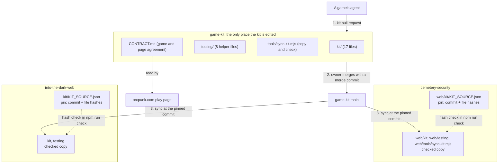

# game-kit, the shared web game kit in its own repo — Architecture Spec

> **As of 2026-10-28; Orkid Garden's bot as of OrkidGarden-Game#182's merge.** Three games vendor the
> kit, not two: OrkidGarden-Game (`web/`) joined with its Windows-check fix (#14). Unit 5, the
> pin-moving bot in every game, has landed for Into The Dark and, with OrkidGarden-Game#182, for Orkid
> Garden. Cemetery Security's workflow file sits on `dev`, where its schedule never fires
> (cemetery-security#763). `CLAUDE.md` and `README.md` describe the by-hand pin move it uses meanwhile.

## In Plain Language

The **kit** is the code every ORC PUNK web game needs and none should write twice: keyboard and touch input, the list of actions both feed, the game clock, moving between screens, the agreement between a game and the page that shows it, and cleaning up when the player leaves. It is 17 small files with no outside dependency, plus 8 helper files its tests use.

Today the kit lives inside the Cemetery Security repo, and the second game, Into The Dark, holds a copy. That was the plan while there was one game: the owner decided on 2026-10-11 that the kit would move "when a second game needs it". It now does. Into The Dark cannot change the kit it runs on: a change has to be made in another game's repo, by another agent, and copied back. The owner, 2026-10-13: "now there's two games being built for the site, sound like we should do it, like the input manager for our games". This spec moves the kit to its own repo, `game-kit`, and makes both games equal users of it.

Games do not install the kit as a package. Each game **copies the kit's files into its own repo and commits them** (a "vendored" copy), and keeps a small file, the **pin**, that records which exact commit of `game-kit` the copy came from and a fingerprint (a SHA-256 hash) of every copied file. A **check** in the game's own test run recomputes those fingerprints and fails if any file was edited by hand. So a game always builds from files it holds, nothing changes under it without a pull request in its own repo that its own check has passed, and the kit can only be changed in one place. Every game runs the latest kit: a workflow in each game moves its pin to `game-kit`'s `main` after a kit change merges (see "Every game on the latest kit"). On the day each game switches, not one byte of its kit files changes: only the pin says where they came from.

## Architecture at a Glance



A change travels one way. It is made in `game-kit`, reviewed there, and merged to `main`. A game then moves its pin to a commit on `main` and runs the sync tool, which copies that commit's files in and records their hashes. From then on the game's own `npm run check` proves the copy is untouched, without needing access to `game-kit`. After a kit change merges, each game's own `kit-bump` workflow moves its pin, runs that game's check, and merges the move if it passes, unless the change is held for the owner. `CONTRACT.md` is read by the games and the site and is never copied.

## How It Works (Technical)

### Where the other repos were read

Every statement this spec makes about another repo was read at one of these commits. A hand-off that quotes a file quotes it as it stood there; if the quoted text is gone, the claim needs checking again.

| Repo | Commit | What was read there |
|---|---|---|
| `cemetery-security` | `1a9a2e55bc07f422c8abd98b4705199dabdc56c4` (on `feat/web-game-kit` only) | The first import's source: `web/kit` and the eight helper files. |
| `cemetery-security` | `50eecdc016ab2e0f78cd5726c7485859c79198f7` (`dev` when the spec was written) | The second import's source; `specs/web-game-kit.md` ("The host contract", "Theme by inheritance", "Theme variables in the contract"); `web/package.json` (`check`, TypeScript `^7.0.2`); `.github/workflows/web.yml` (runs `npm run check` for `web/**`, Node 22). |
| `cemetery-security` | `39654d7e165fa3635be02571d64025ff16c7d182` (`dev` on 2026-10-13, later the same day) | Checked again: `git diff 50eecdc 39654d7 -- web/kit web/testing specs/web-game-kit.md web/package.json .github/workflows/web.yml` is empty, so everything in the row above holds here too. |
| `cemetery-security` | `994b63f9cbc0a2c52015b0619c474a8f6dd2d7ad` (`main`, the default branch, on 2026-10-28) | For the note under the title: `.github/workflows/` holds no `kit-bump.yml`. |
| `cemetery-security` | `1f22c72a5f98a4af84e91239702283478e650fec` (`dev` on 2026-10-28) | For the note under the title: `.github/workflows/kit-bump.yml` (`KIT_ROOT: web`, `KIT_BRANCH: dev`) and `web/kit/KIT_SOURCE.json`. |
| `into-the-dark-web` | `c0220ab57639bbf5daca040cc8b43b4684c3e458` (`main`) | `kit/` (17 files and the pin), `testing/`, `tools/sync-kit.mjs` and its test, `game/mount-game.ts` (the `scrollIntoView` call), `tsconfig.json` (`vite/client`), `package.json` (TypeScript `~5.9.3`, lint with zero warnings), `.nvmrc` (25). |
| `into-the-dark-web` | `404ba2a93968440c5f164605a5f0c77fcac0d346` (`build/parity`, the working branch) | Checked again: `kit/`, `testing/`, `tools/sync-kit.mjs`, `tsconfig.json` and `.nvmrc` are the same as on `main`, and the `scrollIntoView` call is still in the Play branch of `game/mount-game.ts`. |
| `into-the-dark-web` | `985a6a5a653cbf532aa3df079267a0eaf7dbcd96` (`main` on 2026-10-28) | For the note under the title: `.github/workflows/kit-bump.yml` (`KIT_ROOT: .`, `KIT_BRANCH: main`) and `kit/KIT_SOURCE.json`. |
| `OrkidGarden-Game` | `4205d58b6cc686c18d99110d46ec7a1cf78ba4c2` (`master`, the default branch, on 2026-10-28) | For the note under the title and unit 5: the kit is vendored under `web/` (`web/kit/KIT_SOURCE.json`, which names `game-kit` at `b1cadfa`), and `.github/workflows/` holds no `kit-bump.yml`. |
| `OrkidGarden-Game` | `63be2a33d61025b26a630d5ac8d69ee61582d51c` (head of OrkidGarden-Game#182, base `master`, on 2026-10-30) | For the note under the title and unit 5: `.github/workflows/kit-bump.yml` is `templates/kit-bump.yml` with only `KIT_ROOT: web` and `KIT_BRANCH: master` changed, so `KIT_MERGE` stays `merge`. |
| `OrcPunk-dotcom` | `b9a3e8b627910398a70e9569281e3e845ef73d83` (`main`) | `docs/specs/game-pages.md`: the two lines quoted in "Hand-off: the site" and the decision-table answer quoted in Cemetery Security's step 6. |

### The repo on day one

| Path | Job | Copied by games |
|---|---|---|
| `kit/` | The kit: `actions`, `clock`, `host`, `keyboard`, `lifecycle`, `page`, `screens`, `touch`, each with a `.test.ts`, plus `boundaries.test.ts`. 17 files. | Yes |
| `testing/` | What the kit's tests import: `fake-history.ts`, `fake-page.ts`, `fake-time.ts`, `recording-target.ts`, `imports.ts`, `literals.ts`, and the tests of the last two. 8 files. | Yes |
| `tools/sync-kit.mjs` | Copies a pinned commit into a game and checks the copy. | Yes |
| `tools/sync-kit.test.ts` | The tool's test. Runs here only. | No |
| `CONTRACT.md` | What a host page and a game promise each other. | No, linked to |
| `README.md` | What the repo is, how a game adopts the kit, the merge rule, the change flows. | No |
| `CLAUDE.md` | Rules for agents working here. | No |
| `package.json`, `package-lock.json`, `tsconfig.json`, `eslint.config.js`, `.nvmrc`, `.github/workflows/check.yml` | The repo's own check. | No |

**One rule holds the layout together:** everything under `kit/` and `testing/` is copied into every game byte for byte, and nothing else lives in those two folders. So `game-kit` has no `kit/KIT_SOURCE.json`: a game's pin sits at that path and a folder copy would overwrite it. `kit/` and `testing/` stay side by side because each imports the other by relative path.

**The repo's own check.** `npm run check` is `tsc --noEmit && eslint . --max-warnings=0 && vitest run --reporter=verbose`. Dev dependencies only: `typescript` `~5.9.3`, `vitest`, `happy-dom`, `@types/node`, `eslint`, `@eslint/js`, `typescript-eslint`. No `dependencies` block, no `vite`, no `pixi.js`: the kit imports nothing outside itself, and one of its own tests holds that. `tsconfig.json` includes `kit`, `testing` and `tools` and sets `"types": ["node"]` (Into The Dark's also names `vite/client`, which this repo does not install). `.nvmrc` is `22`, the lower of the two games' Node versions. The lint rules are Into The Dark's, because that game lints the copied files with zero warnings allowed and may not edit them. One CI job runs `npm ci` and `npm run check` on pull requests and on pushes to `main`. The repo is public (since 2026-10-14) under the MIT licence, the owner's choice ("MIT is fine"); `package.json` stays `private` so it is never published as a package.

### The two import commits

The kit arrives as two commits, each made by command and each touching only `kit/` and `testing/`. Two, because the games hold different versions today: Into The Dark is on an older commit, and Cemetery Security has since changed three files. Each game can then switch to a commit that holds exactly the bytes it already has.

```sh
# Run in the game-kit checkout. CS is a Cemetery Security checkout; git archive only reads it.
# The paths are written out, not held in a variable: zsh passes an unquoted variable as one word.
rm -rf kit testing
git -C "$CS" archive <SOURCE_COMMIT> web/kit \
  web/testing/fake-history.ts web/testing/fake-page.ts web/testing/fake-time.ts \
  web/testing/imports.ts web/testing/imports.test.ts web/testing/literals.ts \
  web/testing/literals.test.ts web/testing/recording-target.ts \
  | tar -x --strip-components=1
git add kit testing && git commit
```

| Name | Source commit in `cemetery-security` | What it is |
|---|---|---|
| `IMPORT_OLD` | `1a9a2e55bc07f422c8abd98b4705199dabdc56c4` | The tree Into The Dark is pinned to. On branch `feat/web-game-kit` only. |
| `IMPORT_NEW` | `50eecdc016ab2e0f78cd5726c7485859c79198f7` | `origin/dev` when the spec was written. `dev` has since moved to `39654d7`, with the kit, the helpers and the contract's source file unchanged, so either commit gives the same import and the same `CONTRACT.md`. If `dev` has moved again on the day, the builder uses its head only if `web/kit`, the eight helper files and `specs/web-game-kit.md` are all unchanged from `50eecdc`; otherwise the import and `CONTRACT.md` both come from `50eecdc`, so the 102 tests in unit 1, the `IMPORT_NEW` stat line and the second message's "what changed since the first" still hold. Any later kit edit there reaches `game-kit` through Cemetery Security's hand-off, which lists it at step 3. |

`IMPORT_OLD` and `IMPORT_NEW` stand for the two import commits' own hashes in `game-kit`; they are not refs, so substitute the hashes in the commands below or tag them locally. They are the first two commits on the branch, in that order. Nothing has to sit between them and the branch is never reordered. Each message carries the source repository (`eladrianovalle/cemetery-security`), the full source commit, the source paths, a line saying the copy is byte for byte, and where the earlier history lives (branch `feat/web-game-kit` and pull request #735 there). The second also says what changed since the first: `screens.ts` scrolls only when none of the game is on screen and focuses without scrolling (commit `0e55fe2` on `feat/web-game-kit`, which reached `dev` in the squash `497a92b`, pull request #735).

**Proof the bytes are identical.** Git names a folder by a hash of its contents (a tree hash), so the same hash in two repos means the same bytes.

```sh
git -C game-kit rev-parse IMPORT_OLD:kit        # abb781ce590f02c2ba52bcd6418f40cfd0016c92
git -C "$CS"    rev-parse 1a9a2e55bc07f422c8abd98b4705199dabdc56c4:web/kit   # the same
git -C game-kit rev-parse IMPORT_OLD:testing    # a4430fdffbe8d1879fed58a743b489d24a52fc6e
git -C into-the-dark-web rev-parse c0220ab57639bbf5daca040cc8b43b4684c3e458:testing   # the same

git -C game-kit rev-parse IMPORT_NEW:kit        # 68d7cfe02cbebcae5a9f1d15aadbee2444fee9b1
git -C "$CS"    rev-parse 50eecdc016ab2e0f78cd5726c7485859c79198f7:web/kit   # the same
git -C game-kit rev-parse IMPORT_NEW:testing    # a31a8cd033ddfbc7cbd6646dc38914b2f64bab40

git -C game-kit show --stat --format= IMPORT_OLD   # 25 files, all under kit/ or testing/
git -C game-kit show --stat --format= IMPORT_NEW   # kit/screens.ts, kit/screens.test.ts, testing/fake-history.ts
```

Into The Dark's `kit` folder cannot be compared whole, because it also holds the pin file; its 17 kit files at `c0220ab` were compared one by one with `web/kit` at `1a9a2e5` and match: `git -C into-the-dark-web ls-tree c0220ab kit/` without the pin line lists the same 17 blob hashes as `git -C "$CS" ls-tree 1a9a2e5 web/kit/`. The tests under `kit/` and `testing/` number 98 at `IMPORT_OLD` (89 and 9) and 102 at `IMPORT_NEW` (93 and 9).

### The pin file

`kit/KIT_SOURCE.json` in a game (`web/kit/KIT_SOURCE.json` in Cemetery Security).

Before, in Into The Dark today: `repository` names `cemetery-security`; `commit` is `1a9a2e5…`; `branch` is `feat/web-game-kit`; `copies` has nine entries (`web/kit` to `kit`, then each of the eight helper files by name); `sha256` has 25 entries.

After:

```json
{
  "_comment": "Where the vendored kit comes from. The files listed under sha256 are byte-for-byte copies from this commit of game-kit. Change none of them by hand: change the kit in game-kit, move the commit here, and run `node tools/sync-kit.mjs --from <path to a game-kit checkout>`.",
  "repository": "git@github.com:eladrianovalle/game-kit.git",
  "commit": "<40 hex characters: a commit on game-kit main>",
  "copies": [
    { "from": "kit", "to": "kit" },
    { "from": "testing", "to": "testing" },
    { "from": "tools/sync-kit.mjs", "to": "tools/sync-kit.mjs" }
  ],
  "sha256": { "kit/actions.test.ts": "…" }
}
```

- `repository` is for people. The tool never reads it: a commit hash names its content whichever checkout it is read from.
- `commit` is a full hash and must be on `game-kit` `main` before the game's pull request merges.
- `branch` is removed. A branch name is what let today's pin, which no main branch contains, look legitimate.
- `copies` shrinks because `testing` is now copied as a folder: in `game-kit` it holds only the eight helpers. A folder copy writes the files that exist at the pinned commit and deletes nothing, so Cemetery Security's own `web/testing/bot-tools.test.ts` and `release.test.ts` are never touched. `to` paths are relative to the folder above the tool, so the same entries serve both games.
- `sha256` is one hash per copied file, written only by the tool: 26 entries with the tool, 25 without.

Into The Dark's first pin has only the first two `copies` entries (see its hand-off).

### Changes to the sync tool

`tools/sync-kit.mjs` starts as Into The Dark's file at `c0220ab`. The six changes below were sketched and run in a throwaway copy during the proofread. It has three forms: `--from <checkout>` copies the pinned commit in and records hashes; `--from <checkout> --check` changes nothing and fails if any file differs from the pinned commit; `--check` alone fails if any file differs from its recorded hash and needs no other checkout, which is why it can run in a game's CI. The tool reads the other checkout through git objects only (`git show`, `git ls-tree`, and for changes 2 and 3 `git cat-file`, `git merge-base --is-ancestor` and `git rev-parse`), never its working files, so that checkout's branch and uncommitted work do not matter. The copy and hash logic is kept. Every exit has one of three codes: 0, all is as it should be; 1, a file differs or the pin is not on main; 2, the tool cannot tell (a bad pin, a bad checkout, a commit or path it cannot find). The changes:

1. **Wording.** The header and the messages that name Cemetery Security say "a game-kit checkout". The success line `kit/ and testing/ match` becomes "the vendored kit files match".
2. **One-line errors.** Every error prints one line and no stack trace. That takes two changes: git's own stderr is silenced where the tool reports the failure itself, and the errors the script throws today (`<path> does not exist at <commit>`, a pin that records no hashes) are caught and printed as one line, each with exit 2. A pin that records no hashes is an error under `--check` alone, which has nothing else to compare with; `--from --check` needs none. A pinned commit the checkout does not have: `sync-kit.mjs: <commit> is not in <checkout>. Is that a game-kit checkout, and has it been fetched?`, exit 2. The tool looks for the commit before it asks change 3's question.
3. **Is the pin on main?** With `--from`, the tool asks whether the pinned commit is an ancestor of `origin/main` in that checkout. Exit 0 from git: on main. Exit 1: not on main; `--from` copies, records hashes, adds the note `sync-kit.mjs: note: <commit> is not on origin/main of <checkout>` and exits 0, while `--from --check` exits 1 with `sync-kit.mjs: <commit> is not on origin/main of <checkout> (origin/main there is <short hash>). Fetch that checkout and try again; if it still fails, the kit change has not merged.` Any other exit, including a checkout with no `origin/main`: exit 2 with `sync-kit.mjs: <checkout> has no origin/main to compare with. Is it a clone of game-kit?` That exit comes before anything is written, for plain `--from` as well. The check reads the checkout as last fetched. It is evidence for the owner, who merges kit first; it is not a gate.
4. **A failed hash check says what to do.** After the file list: if the change is wanted it belongs in `game-kit` (README, flow (c)); to discard it, run `node tools/sync-kit.mjs --from <game-kit checkout>`.
5. **`--root <dir>` stays as it is**, documented as "used by the tests" and nothing else.
6. **Nothing is written until every entry is found.** The tool lists the files of every `copies` entry at the pinned commit before it writes any. Today a pin whose commit lacks one entry (for example a three-entry pin at a commit with no `tools/sync-kit.mjs`) copies `kit/` and `testing/`, then exits without recording hashes. With the change it prints `sync-kit.mjs: <path> does not exist at <commit>`, exits 2, and leaves every game file and the pin as they were. This is what stops a sync leaving a game half-copied with no hashes recorded.

The tool copies itself. Overwriting a running script is harmless because Node has already read it; the README says to run the command once more if `tools/sync-kit.mjs` was among the copied files.

**The tool's test** builds everything it needs in a temp folder: `git init` on a tiny source repo, identity passed with `-c user.name=… -c user.email=…`, `refs/remotes/origin/main` set with `git update-ref`, a pin beside an empty game folder, and the script driven with `--root`. It reads no pin from the repo it runs in. The cases are listed in unit 1's criteria.

### Hand-off: Cemetery Security

This repo belongs to another agent. `game-kit`'s builder edits nothing there; it opens an issue carrying this section and unit 2 word for word, with the pinned commit in full. Throughout, `<base>` means the branch your pull request targets.

**What changes: nothing in the kit files.** `web/kit/` and the eight helper files in `web/testing/` stay at the same paths with the same bytes. They stop being the original and become a checked copy, so no import line in `web/game` changes and neither `web/vite.config.ts` nor `web/tsconfig.json` is edited.

Steps, run in `web/` (the tool treats the folder above `tools/` as its root, so paths in the pin need no `web/` prefix). The `git diff` commands in this section and in unit 2 are the exception: run those from the repo root, because git reads their paths relative to the current folder and from `web/` they match nothing.

1. Write `kit/KIT_SOURCE.json` as in "The pin file", with all three `copies` entries, no `sha256` yet, and `commit` set to the head of `game-kit` `origin/main`.
2. Copy the tool in: `git -C <game-kit> show <commit>:tools/sync-kit.mjs > tools/sync-kit.mjs`, with the commit hash typed out (in zsh, `$VAR:tools/…` is rewritten by the shell). Check the file is not empty: an empty script exits 0 and prints nothing.
3. `node tools/sync-kit.mjs --from <game-kit> --check`. Expected: exit 0 and the line `sync-kit.mjs: the vendored kit files match <commit>`.
4. `node tools/sync-kit.mjs --from <game-kit>`. Expected: `sync-kit.mjs: copied 0 file(s) from <commit>`, and the pin now holds 26 hashes.
5. In `web/package.json`, `check` becomes `tsc --noEmit && node tools/sync-kit.mjs --check && vitest run --reporter=verbose && vite build && node tools/check-dist.mjs`.
6. In `specs/web-game-kit.md`, the section headed "The host contract" keeps its heading, so existing links still land, and its body becomes a pointer to `game-kit`'s `CONTRACT.md`. The two entries that begin "Theme by inheritance" and "Theme variables in the contract" under Key Decisions and Non-Goals are marked superseded, citing the owner's answer in the site spec's decision table ("Yes: the site passes nothing; each game sets its own font"). That ruling is why this edit to an approved spec needs no new approval.
7. The root `CLAUDE.md` gains one rule: `web/kit/`, the eight helper files and `web/tools/sync-kit.mjs` are vendored from `game-kit` and not edited by hand.

**If step 3 lists a file under `kit/` or `testing/`**, the kit was edited here after the import. Nothing has been copied, so nothing is lost. Take the edit as a diff against the second import's source commit, from the repo root and naming the kit's own files only (`web/testing/` also holds this game's own tests): `git diff <source commit>..HEAD -- web/kit web/testing/fake-history.ts web/testing/fake-page.ts web/testing/fake-time.ts web/testing/imports.ts web/testing/imports.test.ts web/testing/literals.ts web/testing/literals.test.ts web/testing/recording-target.ts`. Open it as an ordinary kit pull request (flow (a) below), and once it is on `main` pin that commit and start again from step 3.

`.github/workflows/web.yml` needs no change: it already runs `npm run check` on pull requests that change anything under `web/`. It does not run on pushes, so a direct push to `dev` is not hash-checked until the next pull request.

### Hand-off: Into The Dark

Also another agent's repo, with work in progress. The issue carries this section and unit 3 word for word, with `IMPORT_OLD` in full. `<base>` means the branch your pull request targets; do not assume it is `main`, which is far behind the working branch.

**What changes now: the pin, and the words that name the kit's source.** No kit file, no helper file, no tool file.

1. In `kit/KIT_SOURCE.json`: reword `_comment` as in "The pin file"; `repository` names `game-kit`; `commit` is `IMPORT_OLD`; delete `branch`; `copies` becomes exactly `kit` to `kit` and `testing` to `testing`.
2. `node tools/sync-kit.mjs --from <game-kit>`, with your existing script. Expected: `copied 0 file(s) from <IMPORT_OLD>`.
3. `git status --short` shows `kit/KIT_SOURCE.json` and nothing else under `kit`, `testing` or `tools`. In the pin's `sha256` block four keys change place (`testing/imports.test.ts` now comes before `testing/imports.ts`, and likewise for `literals`), because a folder copy lists files in git's order; `git diff` shows that as two lines removed and two added. No hash changes value. That is the proof your kit bytes did not move.
4. `CLAUDE.md`, `README.md` and `specs/into-the-dark-web.md` stop calling the Cemetery Security repo the kit's source, and the spec's open question "The kit's home" is closed.

You keep your own `tools/sync-kit.mjs` and `tools/sync-kit.test.ts` for now. The old script reads the new source correctly; only its messages still say "cemetery-security checkout".

**What changes when you next move the pin** (information, not part of this work; your own plan decides how to check it):

- Any commit on `main` after `IMPORT_OLD` holds the newer `screens.ts`. Before: every screen change after the first scrolls the game's root to the top of the page, then focuses. After: the page scrolls only if no part of the scroll target is on screen; while any of it is visible, focus moves without scrolling. A new optional `scrollTarget` defaults to the root.
- Two risks. A second scroll on entering Play, where your own call `element.scrollIntoView({ block: 'start' })` in the Play branch of `game/mount-game.ts` still runs. And a heading left above the visible area when a visitor part-way down a tall screen moves to a short one; if that happens, name a `scrollTarget` or scroll for yourself in game code.
- `npm run check` is unlikely to show either: no test of yours asserts on scrolling, and the test page gives every box zero size.
- You cannot take any other kit change before this one. Pins move along one line of history.
- In that same pull request, add the third `copies` entry (`tools/sync-kit.mjs`) and delete your own `tools/sync-kit.test.ts`, which asserts the old success wording. The tool's test lives in `game-kit`.

### Hand-off: the site

One comment on eladrianovalle/OrcPunk-dotcom#84. The site spec (`docs/specs/game-pages.md`) says the mount contract "already exists in the Cemetery Security repo (`specs/web-game-kit.md`)" and names "Owner: Cemetery Security repo (the build and the contract text)". The comment says: the contract text is now `game-kit/CONTRACT.md`, owned by `game-kit`, with both corrections that spec asked for already made; its pointer and its owner line for the text are out of date. Each game's own font, colour and cross-origin work stays where that spec put it.

### The contract text

`CONTRACT.md` is the section "The host contract" from `cemetery-security:specs/web-game-kit.md` at the second import's source commit. It arrives in two commits so the second shows exactly what was corrected.

- **First commit:** the section as it stands. Only the heading level and the game-specific import path in the usage example change, so it still carries Cemetery Security's wording and path comments (`// web/kit/host.ts`, `// web/game/main.ts`, "decided by the first unit and pinned in its test").
- **Second commit:** the file opens with "This replaces the section 'The host contract' in `cemetery-security:specs/web-game-kit.md`. Where the two differ, this file is right." The code block that copies `kit/host.ts` is replaced by one line: "The types are `kit/host.ts`; that file is the contract's code." Wording and path comments that belong to Cemetery Security alone are reworded to name no game. And the two corrections the site spec asked for (its requirements 5 and 6) are made, which touch three items:

| Today | Corrected |
|---|---|
| Host item 1 ends "It carries the font and colour the game should inherit." | The host passes no font, colour or background to the game; the element may reset all three to browser defaults. |
| Game item 2, "Theme by inheritance." | "Its own look." The game sets its own font, text colour and background on its root, and reads no CSS variable of the host's. |
| Host item 4, "Same address", served "from the host's own origin". | "Side by side." The three are served from one folder, which may be on another origin than the page. The game finds its files relative to `game.js`'s own address (`import.meta.url`), and the server must allow cross-origin reads. |

The corrections are text only. `kit/host.ts` is types and names no style and no address, so no kit file changes and no game re-syncs for them.

### The change flow

**The merge rule.** A game may be built and shown green against a kit branch commit, as evidence for the kit pull request. A game's pull request merges only after the kit change is on `game-kit` `main`. `game-kit` merges with a merge commit, never a squash or a rebase, because both mint new commit hashes and leave the commit the game tested on no branch. The owner merges in all three repos, kit first. That order is the control. The tool's `--from --check` output, pasted into the game's pull request, is the evidence he reads.

**What a kit pull request must contain**, written for a reader who knows neither game:

1. What changes for a game that uses the kit: behaviour before and after, and which files.
2. Why: which game needs it, with a link to that game's pull request or issue.
3. Breaking or not. Breaking means a game must edit its own code to adopt, or will behave differently without editing anything. If additive, name the default that keeps the old behaviour (`scrollTarget` is the model).
4. Evidence: the kit branch commit a game pinned and its `npm run check` result there, for every game the change touches. If the change can be seen or felt, also what was watched in a real browser, and in which game.
5. Every game: where it uses what changed, by file and quoted call, and what it must do to adopt, or "nothing" with the reason.
6. Whether `CONTRACT.md` changes. If it does, the site is a party; link the site issue.
7. The kit tests added or changed, named by the behaviour they hold.

**Who reviews.** The review and response fleet took the repo on on 2026-10-13 (eladrianovalle/orc-review#178, not this spec's work): its reviewer comments on every pull request, its responder answers by adding commits and never by force-pushing, rebasing or squashing, and the owner merges. The import pull request carries the hash commands above and their output as its evidence.

**(a) A kit change one game needs.**

1. The game's agent branches `game-kit` from `origin/main` in its own clone, makes the change with tests, gets `npm run check` green, and opens the kit pull request with the seven items. The change is additive: an existing function called with the same arguments behaves as before.
2. The asking game's agent pins the kit branch in a draft game pull request, runs `npm run check` there, and plays it if the change can be seen or felt. That is item 4.
3. The owner merges the kit pull request with a merge commit.
4. Within the hour, each game's `kit-bump` workflow moves its pin and merges the move once that game's own check passes. Every game's repo is now on the change; the bot's merge starts no workflow, so nothing deploys it until the game's workflows next run.
5. The asking game uses the new code in an ordinary pull request of its own. Its pin has already moved.

**(b) A change that is not additive.** Its title starts `BREAKING:`, and item 5 names the edits each game needs. On merge each game's `kit-bump` workflow still opens its pin move, but merges none of them: each waits for the owner. The edits each game needs are pushed to that game's pin-move pull request, so the pin and the code move together, and the owner merges it once its checks pass. Prefer an additive change with a default that keeps the old behaviour: it costs one pull request instead of one per game.

**(c) A hand edit caught by the hash check.** `npm run check` fails with `these files differ from the hashes recorded for <commit>`.

1. Do not sync first. A sync would overwrite the edit.
2. Save it, from the folder that holds `tools/` (`web/` in Cemetery Security): `git diff -- kit testing tools/sync-kit.mjs`, or if it was committed, compare the file with `git -C <game-kit> show <pinned commit>:<path>`.
3. If the edit is wanted, apply it on a `game-kit` branch and follow (a).
4. If it is not, `node tools/sync-kit.mjs --from <game-kit>` restores the pinned bytes.
5. Never quiet the check by editing a hash in the pin.

### Every game on the latest kit

The amendment of 2026-10-14. Units 4 to 6 build it.

**The bot runs in each game.** `game-kit` is public, so a game can read it with no token of its own. Each game copies `templates/kit-bump.yml` once to `.github/workflows/kit-bump.yml` and sets three values: `KIT_ROOT` (the folder holding its `tools/` and `kit/`), `KIT_BRANCH` (where its work lands) and `KIT_MERGE` (how it merges pull requests). The workflow runs every hour and on demand, one run at a time, with the game's own token. It clones `game-kit`'s `main` and runs `tools/kit-bump.mjs` from that clone, so a fix to the bot reaches every game without an edit in any of them. One run is two jobs, so the game's check, with every install script, never runs where the token can write. `check`, whose token can only read:

1. Stop if the game has no pin, if the pin already names `main`, or if a pin move to `main` is already open.
2. On a branch `kit/<short hash>`: move the pin, run the game's own sync tool, commit only the pin and the files it wrote.
3. Run the game's check (`npm ci && npm run check` in `KIT_ROOT`), with no token in its environment, and record the kit commit and whether it passed. A pull request opened with a repo's own token does not start that repo's other workflows, so the bot cannot wait for them.

`publish`, on a fresh runner with a fresh checkout, the only job that can write. It runs nothing of the game's but its sync tool: no install, no test. It takes the check's result from one file, unpacked into a folder of its own, and believes it only for the commit the workflow recorded before the check ran, which must be on `main` and after the pin. A result that names no commit is refused while a move is due, so the check can say it passed or failed, and nothing more. Then:

4. Repeat step 1. Decide from every commit on `main`'s first-parent line since the pin, each looked up as the pull request that merged it. **Hold** if any came without a pull request, has a title starting `BREAKING:`, or changes `kit/screens.ts` or `kit/page.ts` (renaming either counts) without the label `additive`. Otherwise merge when green.
5. Make the same pin move again, as in step 2, so the commit the check ran in is never pushed. Push it and open "Move the kit pin to game-kit <short hash>", naming each kit change, the check's result and the decision. A `kit/<short hash>` branch already on the game's origin with no open pull request is the bot's own leftover, from a run that failed to open its pull request or a pin move closed unmerged, and the push replaces it. Close older open pin moves (branches `kit/<short hash>`) as replaced; one that holds someone's edits is left open with a comment.
6. Merge it with `KIT_MERGE` if the check passed and nothing is held. Otherwise comment why and leave it open. A failed sync or check exits 1, so the run shows red.

The game's repo must allow workflows to open pull requests (Settings, Actions, General). No secret is used anywhere.

### Failure modes

| Failure | What catches or resolves it |
|---|---|
| A pin names a commit that is not on `main` | The game's CI stays green: the hash check knows nothing of `main`. `--from --check` exits 1 with the not-on-main message, and the owner merges kit first. |
| A pin names a commit the checkout lacks, or the checkout has no `origin/main` | Exit 2 with one line in each case. |
| A pin lists a path its commit does not hold | Exit 2 with one line, before anything is written (change 6). |
| A stale `game-kit` checkout | `--from --check` says "not on main" for a commit that is. The message says to fetch. A checkout fetched before a force-push of `main` can pass falsely; nothing catches that. |
| A hand edit to a copied file | `npm run check` fails locally and in CI and names the file. Flow (c). |
| A hand edit to a file together with its hash in the pin | Not caught by CI. Caught by the next `--from --check`, which compares bytes with the pinned commit, and in review: a hash that changes value while `commit` does not. Accepted. A hash edited on its own fails `--check` in CI. |
| A sync from a dirty checkout, or one on another branch | Nothing goes wrong: the tool reads the pinned commit, never the working files. |
| A sync over an uncommitted hand edit in the game | The edit is overwritten. Flow (c) step 1 and the failure message both say to save it first. No guard. |
| A kit change passes the kit's tests and breaks a game | That game's `kit-bump` run fails its check and does not merge: the game stays on its last good pin, the pull request stays open with the failing output, and the run shows red. The failing case becomes a kit fix and a kit test. Nothing checks a game before the kit change merges; item 4 is the author's evidence for the asking game only. |
| A change the games' tests cannot see (scrolling, focus, sizing) | Not caught by any check. The bot holds every pin move for a kit change that touches `kit/screens.ts` or `kit/page.ts` without the `additive` label, so a person looks first. The reviewer asks of every kit pull request: with the same arguments, does any existing function behave differently? |
| A game has no pin file yet, or its sync fails | No pin: the run does nothing and says so in its summary. A failed sync: nothing is pushed, and the run shows red. |
| A game's pin move is still open when the next kit change merges | The newer pin move replaces it: the bot closes the older one, because a pin holds every change before it. An older one that holds someone's edits (flow (b)) is not closed; the bot comments on it to carry them onto the newer one. |
| A game's repo does not let workflows open pull requests | The run pushes the branch, then fails at opening the pull request and shows red. The setting is named in the template. Once it is on, the next run replaces the branch it left and opens the pull request. |
| A person closes a pin move without merging it | Closing does not decline the kit change: the pin still trails `main`, so the next run opens a new pin move within the hour, replacing the closed one's branch. Edits a person pushed to that branch (flow (b)) are gone from it and survive only under the closed pull request's `refs/pull/<number>/head`. |
| A game deploys or runs CI on a push to its base branch | The bot's merge, made with the repo's own token, starts no workflow there: the repo is on the new kit, its deployed build is not until the game's workflows next run. Not automated. |
| A game's base branch requires status checks | They never run on the bot's pull request, which the repo's own token opened, so `gh pr merge` fails and the run shows red. The next run finds the pin move open and stops quietly; it waits for a person to merge it. |
| A change to the bot breaks it | Every game runs the new bot on its next run, from `main`. Its test runs here first, in `npm run check`; a broken run shows red in every game, and fixing `main` fixes every game. |
| The two games need incompatible behaviour | First an option whose default keeps the old behaviour. If that cannot be done, the owner decides. A game leaving the kit is his call, never an agent's. |
| A kit file is renamed or removed | The sync deletes the old copy if it still has its recorded hash, and fails if it was edited by hand (added after into-the-dark-web#16's review: with the bot merging pin moves, a lingering copy would drop out of the hash check unseen). The kit pull request names it under item 5. |
| A later file in `game-kit`'s `testing/` has the same name as a game's own file there | The sync overwrites the game's file without warning; git shows it in the diff. No guard. |
| Cemetery Security edits `web/kit` between the import and its adoption | Step 3 of its hand-off lists the files; the resolution is written there. |

## Key Decisions

Settled by the owner:

- **Its own repo, `eladrianovalle/game-kit`, with this spec as its first pull request.** His words: "game-kit works". Private at first; made public on 2026-10-14 ("go public"), with the Studio and Claude Code files untracked and nothing personal or confidential kept in it.
- **Of the kit itself, day one holds the 17 files and their test helpers only: exactly what Into The Dark copies today.** The tool, `CONTRACT.md` and the repo's own config sit beside them. The helpers include `testing/literals.ts`, which no kit file uses but both games' tests import.
- **Games copy the kit in at a pinned commit with a hash check.** Only the source of the copy changes, and Cemetery Security becomes a user like any other game.
- **The repo joins the review and response fleet.** His words: "let's also get it added to the review/response fleet". Done in orc-review#178 on 2026-10-13, so a reviewer exists from this spec's own pull request on.
- **Every game runs the latest kit (amended 2026-10-14).** His words: "i don't really want to have games pinning different versions, just want all games on the latest and the package to support all the games it needs", and "in theory we shouldn't be breaking older games behaviors with improvements to game kit". He approved the amendment in the session that wrote it ("yes, amend"). It replaces "each game moves its pin when it chooses" with the bot in each game and the additive rule below. Copies, pins and hash checks stay as they were.

Decided in the debate, with what was rejected:

- **Two import commits, not one.** One commit at Cemetery Security's current version would make Into The Dark's switch of source also a behaviour change nobody has tested there. With two, each game switches to bytes it already holds.
- **No history rewrite.** The import messages name their sources, and the earlier commits stay in `cemetery-security`. Carrying one feature branch's commits across was not worth rewriting their paths.
- **A package registry, a git submodule or a git subtree: rejected.** The owner ruled out a registry. When this was decided, `game-kit` was private, so a submodule or a clone at build time would have needed each game's CI to have access to a second private repo. A committed copy with a hash check needs none.
- **No tags, versions or changelog.** A pin is already an exact version, every game is moved to the latest by the bot, and the kit pull request body is the release note.
- **A game's pin must be on `main` before the game merges.** The alternative, letting a game merge on a kit branch commit, is how Into The Dark came to be pinned to a commit that only a feature branch keeps alive. Recorded as an assumption for the owner (open question 7).
- **The on-main check lives in the tool, as evidence and not as a gate.** The rule failed once when it lived only in people's heads. When this was decided, `game-kit` was private, so no game's CI could run it, and the spec says plainly that the owner's merge order is the control. Since the amendment of 2026-10-14 a pin the bot moves always names `main`'s head; a game's own `npm run check` still never reads `game-kit`.
- **One compiler in `game-kit`, TypeScript `~5.9.3`.** Type-checking under both games' TypeScript majors here was rejected: each game's own `tsc` already covers the copied files every time it moves its pin. The older compiler is used so a kit change cannot rely on something only the newer one accepts.
- **No freeze on kit edits in Cemetery Security.** Nothing could enforce it before that repo has a hash check. The first command of its adoption lists any edit made in the meantime.
- **The tool is copied into games; its test is not.** The copied tool is hash-pinned to a commit where its test passed. Copying the test too would cost Cemetery Security an edit to a config line another of its branches is changing, and the file would run there without being type-checked.
- **Into The Dark pins the first import with two `copies` entries and keeps its own script.** Rejected: ordering the branch so one commit holds both the old kit and the new tool. It worked, but a review fix to the tool would have forced a rewrite of an open pull request and changed every hash already checked.
- **No browser checks prescribed for another repo.** The debate drafted six for Into The Dark's later move to the newer screen navigation, and a phone check for the owner. That is another repo's future work on its own schedule, and its agent knows its code better. The behaviour difference and the two risks go in its issue.
- **No stand-in review in the fleet's format.** A fresh-agent review posted as APPROVED or REJECTED by a session the author started could not be told from a real fleet review later.
- **Shared build tooling does not move now.** The owner's decision: it follows once two games have shown what is really common.
- **Hand-offs name places by file and quoted text, never by line number.** One line number cited in the debate was wrong within hours.

Decided for the amendment, with what was rejected:

- **One package, one pin, moved by a bot.** The kit's parts are separate files that barely import each other: the gamepad work added eleven files and changed no existing one. What tied them together was that a game moved its pin by hand and could fall behind. A bot that moves every game on every merge removes that without splitting anything.
- **The bot runs in each game, with that game's own token, and `game-kit` is public.** The owner: "go public". No secret exists anywhere. The cost: nothing runs a game's check before a kit change merges; the game's own run catches it after, and leaves that game on its last good pin.
- **Rejected for now: installing the kit as a git dependency.** Being public removes the reason the original debate rejected it. The copy, the hash check and the bot are built and work, and switching would change every kit import line in both games; it can be revisited on its own.
- **Rejected: Renovate or Dependabot to move pins.** Neither can see which files a kit change touched or how it was titled, so neither can hold a change for the owner except by version number, and the kit has none.
- **Rejected: a write token held by `game-kit` (the first version of this amendment).** It worked, but the owner asked for no tokens once the repo is public.
- **Additive by default, held when it is not.** A kit change keeps every existing function's behaviour when called with the same arguments. The bot merges pin moves by itself only then: a `BREAKING:` title, or a change to `kit/screens.ts` or `kit/page.ts` without the `additive` label, makes it wait for the owner. Those two files are where behaviour shows only in a real browser.
- **Rejected: serving the kit from the site at runtime.** A site deploy would change a game's behaviour with no commit and no check in that game, and the games run without the site in their tests, on their dev servers and on their own Pages sites.
- **Rejected: separately pinned packages per lane (input, time, screens, page).** It solves with more pins the problem the bot solves with none.
- **Rejected: moving the page lane behind the host contract.** `kit/page.ts` is the game's half of the contract (it reads the `scroll-margin-top` the contract promises); moving it makes the site an API that must be versioned against games.
- **Rejected: lockstep by hand**, a pin-move pull request per game opened by each kit author. It is the bot done by hand.

## Non-Goals / Cut Scope

- A package, registry, submodule or subtree; tags, versions, a changelog.
- Shared build tooling: `check-dist`, the Pixi build tweak, `extract-constants`, Cemetery Security's literals lint.
- A game's `npm run check` reaching `game-kit`: its hash check reads only the game's own files. Only the game's `kit-bump` workflow reads `game-kit`.
- Each game's own font, colour and cross-origin work. That is the site spec's, in the game repos.
- Tidying the imported files, such as the two test names that still say `web/kit` and `web/game` (in `kit/host.test.ts` and `kit/boundaries.test.ts`), the only game-specific names in kit files. Changing them at import would break byte identity; the first kit pull request that edits either file for another reason renames them.
- A pull request template, a guard against overwriting a hand edit, automatic deletion of removed files, a check of `repository`.

Cut by the final review: seven units became three; the commit-order rule and the special pin commit it existed for; the tool's test as a copied file; `--root` as an adoption path; the unit and browser checks for Into The Dark's later adoption; the code block in `CONTRACT.md` that duplicated `kit/host.ts`; the stand-in reviewer; every line number in a hand-off.

## Risks & Open Questions

1. **Into The Dark will meet a behaviour change it has not tested.** The newer screen navigation scrolls and focuses differently, and automated tests are unlikely to show it. Unit 6 adopts it once, by hand, with a browser check, so the bot starts from every game on the latest kit.
2. **Both hand-offs wait on other agents.** Each game's agent picks its issue up between its own units. Until Cemetery Security adopts, two editable copies of the kit exist and nothing catches an edit there.
3. **The merge rule is a convention.** Turning off squash and rebase merging removes one accident. It does not stop a force-push to `main` (there is no branch protection today), or a game merging first. The fleet's responder is told to add commits only and never to force-push, rebase or squash (orc-review#178); that is an instruction to an agent, not a setting.
4. **A pin move is only as good as each game's tests.** The bot runs each game's own `npm run check`, including Cemetery Security's TypeScript 7, so a compile or test failure stops the merge. A behaviour no test looks at is not caught; the hold on `kit/screens.ts` and `kit/page.ts` covers the two files where that is most likely.
5. **Nobody reviews a kit pull request for its effect on the game its author does not build.** Item 5 of the pull request contents is the author's own account. The fleet's reviewer reads the kit diff and can read both games. Each game's own check then runs against the change in its `kit-bump` run, after merge.
6. **A review can check an import and cannot check a behaviour change.** The import is checkable by hash, and the fleet's reviewer did recompute this spec's hashes. A change to how the kit behaves is read, by the reviewer and the owner, and not run.
7. **Each game runs code from `game-kit`'s `main` with write access to itself.** The `kit-bump` workflow executes `tools/kit-bump.mjs` as it stands on `main`, so whoever can merge to `game-kit` `main` can change what runs in every game. Only the owner merges there. Up to an hour passes between a kit merge and the pin moves.
8. **The hand-off steps were run only in throwaway copies, against a sketch of the tool.** The proofread ran both games' steps and both passed, with `npm run check` green in each (Cemetery Security: 1406 tests). The real tool is written in unit 1, so its exact messages are what unit 1's test pins, and a wording difference there must be carried into the two issues.

Open questions for the owner. The build takes the default unless he says otherwise.

| # | Question | Default the build takes | To change it, he says |
|---|---|---|---|
| 1 | Is Into The Dark running the current kit part of "done"? | Yes, since the amendment: unit 6. | Nothing to say. |
| 2 | Where does the host contract text live? | `game-kit/CONTRACT.md`, owned here, corrected, with a note on OrcPunk-dotcom#84 and a pointer left in Cemetery Security's spec. | "Leave it in Cemetery Security." No `CONTRACT.md`; that repo's agent makes the corrections and the README links there. Into The Dark then cannot change a contract it is bound by. |
| 3 | What stands in for review before the fleet takes the repo on? | Closed: nothing has to. The fleet has reviewed this repo since 2026-10-13. | Nothing to say. |
| 4 | "Cemetery Security deletes its original": a real delete? | No. The files stay at the same paths and become a checked copy, so no import line changes. | "I want it visible." A delete-and-recopy commit; the net diff is the same. |
| 5 | Who installs Studio in `game-kit`, and when? | The coordinator, in its own commit before unit 1, outside the spec pull request. | "Put it in the spec pull request." |
| 6 | Are squash and rebase merging turned off? | Yes, by him, before unit 1's pull request merges: `gh repo edit eladrianovalle/game-kit --enable-squash-merge=false --enable-rebase-merge=false`. It keeps a tested commit reachable. It does not enforce "kit first, then game". | "Leave the settings." The rule then rests on `CLAUDE.md` alone, and one squash repeats today's unreachable pin. |
| 7 | Must a game's pin be on `main` before the game merges? | Yes (an assumption recorded before the debate). | "A game may merge on a branch commit." The on-main check comes out of the tool. |
| 8 | Which compiler does `game-kit` check with? | TypeScript `~5.9.3`, the older. | "Use 7." |
| 9 | Who does Cemetery Security's adoption, and how soon? | Its own agent, from the issue, between its units. | "Do it next." He tells that agent to take it as its next task, which shortens risk 2 to hours. |

## Build Plan

Before the units and not part of any of them: the owner approves this spec by merging its pull request and turns off squash and rebase merging (open question 6), and the coordinator installs Studio (the `/spec` and `/forge` tooling, its config and commands) in `game-kit` in a separate commit that is not part of the spec pull request. Units 2 and 3 depend only on unit 1's merge and not on each other. No unit leaves a game broken: until a game's own agent moves its pin, nothing in that game changes.

### 1. `gk_kit_on_main` — `game-kit` main holds both kits, the tool, and the rules for changing them

What gets built: in `game-kit`, by this spec's builder, on one branch and one pull request merged with a merge commit. `IMPORT_OLD` then `IMPORT_NEW`, each by the command in "The two import commits", as the branch's first two commits. Then, in any order: `package.json`, `package-lock.json`, `tsconfig.json`, `eslint.config.js`, `.nvmrc`, `.github/workflows/check.yml`, `CLAUDE.md`, `README.md`, `tools/sync-kit.mjs`, `tools/sync-kit.test.ts`, `CONTRACT.md`. Review fixes are added as new commits; the branch is never reordered. After the merge the builder opens one issue in each game repo and one comment on OrcPunk-dotcom#84, as the three hand-off sections describe.

**Acceptance criteria:**
- [ ] `git rev-parse IMPORT_OLD:kit` is `abb781ce590f02c2ba52bcd6418f40cfd0016c92` and `IMPORT_OLD:testing` is `a4430fdffbe8d1879fed58a743b489d24a52fc6e`. `git rev-parse IMPORT_NEW:kit` equals `git -C <cemetery-security> rev-parse <source commit>:web/kit` (`68d7cfe02cbebcae5a9f1d15aadbee2444fee9b1` for `50eecdc`), and `IMPORT_NEW:testing` is `a31a8cd033ddfbc7cbd6646dc38914b2f64bab40` for that source.
- [ ] `git show --stat --format= IMPORT_OLD` names 25 files, all under `kit/` or `testing/`; the same for `IMPORT_NEW` names only files under those two folders. Each message carries the source repository, the full source commit and the source paths. `git diff IMPORT_NEW..HEAD -- kit testing` is empty, and `git ls-tree -r --name-only HEAD kit testing` lists exactly 25 files.
- [ ] In a fresh clone, `npm ci && npm run check` passes: type check, lint with zero warnings, the 102 tests under `kit/` and `testing/`, and the tool's. `package.json` has no `dependencies` block and names neither `vite` nor `pixi.js`.
- [ ] The tool's test builds its own source repo and pin in a temp folder and covers, by name: copy and record hashes; `--check` passing; `--check` failing on one changed byte and naming only that file; `--check` failing on a missing file; `--from --check` passing for a commit on `origin/main`; `--from --check` exiting 1 for a commit on a side branch only; plain `--from` for a commit on a side branch only copying, recording hashes, printing the not-on-main note and exiting 0; exit 2 with one line when the checkout has no `origin/main`, for `--from` and for `--from --check`, with nothing written; exit 2 with one line when the checkout lacks the commit; a pin whose commit lacks one `copies` entry exiting 2 with one line and leaving every game file and the pin byte-identical; `--check` alone on a pin with no `sha256` exiting 2 with one line. No case prints a stack trace. `git grep -i cemetery -- tools/` returns nothing.
- [ ] The README states the merge rule, that the on-main check is evidence and not a gate, the seven pull request items, and flows (a), (b) and (c) as numbered steps. `CLAUDE.md` carries the merge rule.
- [ ] `CONTRACT.md` arrives in two commits. The first matches the section headed "The host contract" in `cemetery-security:specs/web-game-kit.md` at the source commit, except the heading level and the import path in the usage example. At the head, `git grep -n -i -E 'should inherit|own origin|Theme by inheritance|export interface' CONTRACT.md` returns nothing, and its first paragraph says it replaces that section.

**Out of scope:** any edit to an imported file; an overwrite guard; deleting files removed upstream; a check of `repository`; any file in a game repo.

### 2. `gk_cs_adopts` — Cemetery Security's kit is a checked copy of `game-kit`

What gets built: in `cemetery-security`, by that repo's agent, from its issue. The steps of "Hand-off: Cemetery Security". Depends on unit 1's merge.

**Acceptance criteria:**
- [ ] `web/kit/KIT_SOURCE.json` exists: `repository` names `game-kit`; no `branch`; `commit` is a commit on `game-kit` `origin/main` that contains `tools/sync-kit.mjs`; `copies` is exactly `kit`, `testing` and `tools/sync-kit.mjs`, each to the same path; `sha256` has 26 entries.
- [ ] Run from the repo root, `git diff --stat <base>..HEAD -- web/kit web/testing` shows only `web/kit/KIT_SOURCE.json`.
- [ ] Run from the repo root, `git diff --stat <base>..HEAD -- web/vite.config.ts web/tsconfig.json` is empty.
- [ ] `web/package.json`'s `check` runs `node tools/sync-kit.mjs --check` after `tsc --noEmit`, and `npm run check` passes.
- [ ] The pull request body carries the output of `node tools/sync-kit.mjs --from <game-kit> --check`, ending in `the vendored kit files match <commit>`.
- [ ] In `specs/web-game-kit.md` the section headed "The host contract" keeps its heading and its body is a pointer to `game-kit`'s `CONTRACT.md`. The root `CLAUDE.md` says `web/kit/`, the eight helper files and `web/tools/sync-kit.mjs` are vendored and not edited by hand.

**Out of scope:** the game's font, colour or cross-origin work; any other tool; how the game imports the kit.

### 3. `gk_itd_switches_source` — Into The Dark's pin names `game-kit`, and nothing else in the repo changes

What gets built: in `into-the-dark-web`, by that repo's agent, from its issue. Steps 1 to 4 of "Hand-off: Into The Dark". Depends on unit 1's merge. Independent of unit 2.

**Acceptance criteria:**
- [ ] `kit/KIT_SOURCE.json`: `repository` names `game-kit`; `commit` is `IMPORT_OLD` (given in full in the issue); no `branch`; `copies` is exactly `kit` to `kit` and `testing` to `testing`.
- [ ] `git diff --stat <base>..HEAD -- kit testing tools` shows only `kit/KIT_SOURCE.json`.
- [ ] Every `sha256` value in the pin is unchanged. Four keys change position, because a folder copy lists files in git's order; none changes value.
- [ ] `npm run check` passes.
- [ ] `CLAUDE.md`, `README.md` and `specs/into-the-dark-web.md` no longer call the Cemetery Security repo the kit's source, and the spec's open question "The kit's home" is closed.

**Out of scope:** the newer `screens.ts`; the vendored tool; any game code.

**The amendment's units (2026-10-14).** Unit 4 is built in `game-kit` on one branch with the amendment itself, as one pull request. Unit 5 is a small pull request in each game; unit 6 is Into The Dark's.

### 4. `gk_kit_bump` — `game-kit` is public, and holds the bot every game runs

What gets built: `tools/kit-bump.mjs` and its test, `templates/kit-bump.yml`, the README's flows and pull request items rewritten to match, and the Studio and Claude Code files untracked. Then the repo is made public.

**Acceptance criteria:**
- [ ] The decision is a pure function of a kit pull request's title, labels and changed files, tested for: no pull request (hold); a `BREAKING:` title (hold); `kit/screens.ts` or `kit/page.ts` changed without `additive` (hold); the same with `additive` (merge when green); a change to `kit/screens.test.ts` alone (merge when green); any other change (merge when green). Several changes since the pin hold if any one does, with every reason.
- [ ] A test with temp repos and a fake `gh` shows one run's two jobs: `check` moves the pin on `kit/<short hash>` with only the pin and the synced files committed, runs the check and records the commit, and pushes nothing; `publish` makes the same pin move again, pushes the branch, and opens the pull request and merges it with the game's method; and that a hold, a failed check, an older pin move, a game already on `main`, an open pin move and a game with no pin each do what "Every game on the latest kit" says.
- [ ] `templates/kit-bump.yml` runs every hour and by hand, one run at a time, uses only the repo's own token, reads `game-kit` over public https, and calls the bot with its three values.
- [ ] No file under `.claude/` or `.studio/` is tracked, and no tracked file holds a personal detail beyond what the owner's GitHub profile already shows.
- [ ] `npm run check` passes.

**Out of scope:** a check of every game before a kit change merges; any game's repo.

### 5. `gk_games_run_bump` — each game runs the bot

What gets built: in `cemetery-security`, in `into-the-dark-web` and in `OrkidGarden-Game`, one pull request each, adding `.github/workflows/kit-bump.yml` from the template with that game's three values (`web`, `dev`, `squash`; `.`, `main`, `merge`; and `web`, `master`, `merge`), and turning on "Allow GitHub Actions to create and approve pull requests". Each pull request names what the repo's own token cannot do in that game: the bot's merge starts no workflow on the base branch, so no deploy and no CI follow it, and a base branch that requires status checks makes the bot's merge fail, because no check runs on its pull request. Each waits on that game having a pin from `game-kit` (`gk_cs_adopts`, `gk_itd_switches_source`); Orkid Garden already has one, so it waits on no unit.

**Acceptance criteria:**
- [ ] The workflow file is the template with only the three values changed.
- [ ] A run started by hand on a game already on `main` ends green with "the pin already names game-kit main" in its summary.

**Out of scope:** any other file in the game.

### 6. `gk_itd_catches_up` — Into The Dark runs the latest kit

What gets built: in `into-the-dark-web`, on top of `gk_itd_switches_source`. Its pin moves to the head of `game-kit` `main`, with the third `copies` entry (`tools/sync-kit.mjs`), so it takes the newer screen navigation and game-kit's tool. Its own `tools/sync-kit.test.ts` is deleted. Its own `element.scrollIntoView({ block: 'start' })` in the Play branch of `game/mount-game.ts` is kept, removed or replaced by a `scrollTarget`, whichever a browser check shows is right, with the reason in the pull request.

**Acceptance criteria:**
- [ ] `kit/KIT_SOURCE.json` names the head of `game-kit` `origin/main` and has three `copies` entries; `node tools/sync-kit.mjs --from <game-kit> --check` exits 0.
- [ ] `tools/sync-kit.test.ts` is gone, `tools/sync-kit.mjs` is game-kit's, and `npm run check` passes.
- [ ] The pull request records a real browser going Title to Play, Play to Settings and back, and a tall screen to a short one, at a desktop size and at a phone size, with no second scroll on entering Play and no heading left above the visible area.

**Out of scope:** any other game code; the gamepad work.

