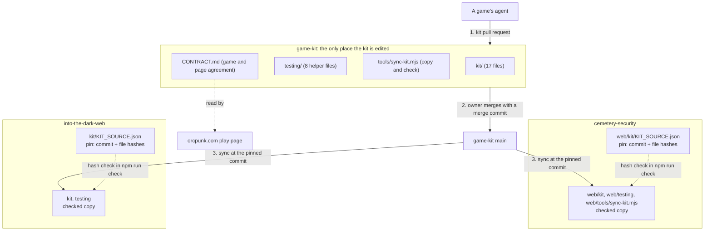

# game-kit, the shared web game kit in its own repo — Architecture Spec

## In Plain Language

The **kit** is the code every ORC PUNK web game needs and none should write twice: keyboard and touch input, the list of actions both feed, the game clock, moving between screens, the agreement between a game and the page that shows it, and cleaning up when the player leaves. It is 17 small files with no outside dependency, plus 8 helper files its tests use.

Today the kit lives inside the Cemetery Security repo, and the second game, Into The Dark, holds a copy. That was the plan while there was one game: the owner decided on 2026-10-11 that the kit would move "when a second game needs it". It now does. Into The Dark cannot change the kit it runs on: a change has to be made in another game's repo, by another agent, and copied back. The owner, 2026-10-13: "now there's two games being built for the site, sound like we should do it, like the input manager for our games". This spec moves the kit to its own repo, `game-kit`, and makes both games equal users of it.

Games do not install the kit as a package. Each game **copies the kit's files into its own repo and commits them** (a "vendored" copy), and keeps a small file, the **pin**, that records which exact commit of `game-kit` the copy came from and a fingerprint (a SHA-256 hash) of every copied file. A **check** in the game's own test run recomputes those fingerprints and fails if any file was edited by hand. So a game always builds from files it holds, nothing changes under it until its own agent moves the pin, and the kit can only be changed in one place. On the day each game switches, not one byte of its kit files changes: only the pin says where they came from.

## Architecture at a Glance



A change travels one way. It is made in `game-kit`, reviewed there, and merged to `main`. A game then moves its pin to a commit on `main` and runs the sync tool, which copies that commit's files in and records their hashes. From then on the game's own `npm run check` proves the copy is untouched, without needing access to `game-kit`. The other game is not affected until it moves its own pin. `CONTRACT.md` is read by the games and the site and is never copied.

## How It Works (Technical)

### The repo on day one

| Path | Job | Copied by games |
|---|---|---|
| `kit/` | The kit: `actions`, `clock`, `host`, `keyboard`, `lifecycle`, `page`, `screens`, `touch`, each with a `.test.ts`, plus `boundaries.test.ts`. 17 files. | Yes |
| `testing/` | What the kit's tests import: `fake-history.ts`, `fake-page.ts`, `fake-time.ts`, `recording-target.ts`, `imports.ts`, `literals.ts`, and the tests of the last two. 8 files. | Yes |
| `tools/sync-kit.mjs` | Copies a pinned commit into a game and checks the copy. | Yes |
| `tools/sync-kit.test.ts` | The tool's test. Runs here only. | No |
| `CONTRACT.md` | What a host page and a game promise each other. | No, linked to |
| `README.md` | What the repo is, how a game adopts the kit, the merge rule, the change flows. | No |
| `CLAUDE.md` | Rules for agents working here. | No |
| `package.json`, `package-lock.json`, `tsconfig.json`, `eslint.config.js`, `.nvmrc`, `.github/workflows/check.yml` | The repo's own check. | No |

**One rule holds the layout together:** everything under `kit/` and `testing/` is copied into every game byte for byte, and nothing else lives in those two folders. So `game-kit` has no `kit/KIT_SOURCE.json`: a game's pin sits at that path and a folder copy would overwrite it. `kit/` and `testing/` stay side by side because each imports the other by relative path.

**The repo's own check.** `npm run check` is `tsc --noEmit && eslint . --max-warnings=0 && vitest run --reporter=verbose`. Dev dependencies only: `typescript` `~5.9.3`, `vitest`, `happy-dom`, `@types/node`, `eslint`, `@eslint/js`, `typescript-eslint`. No `dependencies` block, no `vite`, no `pixi.js`: the kit imports nothing outside itself, and one of its own tests holds that. `tsconfig.json` includes `kit`, `testing` and `tools`. `.nvmrc` is `22`, the lower of the two games' Node versions. The lint rules are Into The Dark's, because that game lints the copied files with zero warnings allowed and may not edit them. One CI job runs `npm ci` and `npm run check` on pull requests and on pushes to `main`. The repo is private and `UNLICENSED`.

### The two import commits

The kit arrives as two commits, each made by command and each touching only `kit/` and `testing/`. Two, because the games hold different versions today: Into The Dark is on an older commit, and Cemetery Security has since changed three files. Each game can then switch to a commit that holds exactly the bytes it already has.

```sh
# Run in the game-kit checkout. CS is a Cemetery Security checkout; git archive only reads it.
HELPERS="web/testing/fake-history.ts web/testing/fake-page.ts web/testing/fake-time.ts web/testing/imports.ts web/testing/imports.test.ts web/testing/literals.ts web/testing/literals.test.ts web/testing/recording-target.ts"
rm -rf kit testing
git -C "$CS" archive <SOURCE_COMMIT> web/kit $HELPERS | tar -x --strip-components=1
git add kit testing && git commit
```

| Name | Source commit in `cemetery-security` | What it is |
|---|---|---|
| `IMPORT_OLD` | `1a9a2e55bc07f422c8abd98b4705199dabdc56c4` | The tree Into The Dark is pinned to. On branch `feat/web-game-kit` only. |
| `IMPORT_NEW` | `50eecdc016ab2e0f78cd5726c7485859c79198f7` | `origin/dev` on 2026-10-13. If `dev` has moved, its head on the day. |

They are the first two commits on the branch, in that order. Nothing has to sit between them and the branch is never reordered. Each message carries the source repository (`eladrianovalle/cemetery-security`), the full source commit, the source paths, a line saying the copy is byte for byte, and where the earlier history lives (branch `feat/web-game-kit` and pull request #735 there). The second also says what changed since the first: `screens.ts` scrolls only when none of the game is on screen and focuses without scrolling (commit `0e55fe2`, merged in #735).

**Proof the bytes are identical.** Git names a folder by a hash of its contents (a tree hash), so the same hash in two repos means the same bytes.

```sh
git -C game-kit rev-parse IMPORT_OLD:kit        # abb781ce590f02c2ba52bcd6418f40cfd0016c92
git -C "$CS"    rev-parse 1a9a2e55bc07f422c8abd98b4705199dabdc56c4:web/kit   # the same
git -C game-kit rev-parse IMPORT_OLD:testing    # a4430fdffbe8d1879fed58a743b489d24a52fc6e
git -C into-the-dark-web rev-parse HEAD:testing # the same

git -C game-kit rev-parse IMPORT_NEW:kit        # 68d7cfe02cbebcae5a9f1d15aadbee2444fee9b1
git -C "$CS"    rev-parse 50eecdc016ab2e0f78cd5726c7485859c79198f7:web/kit   # the same
git -C game-kit rev-parse IMPORT_NEW:testing    # a31a8cd033ddfbc7cbd6646dc38914b2f64bab40

git -C game-kit show --stat --format= IMPORT_OLD   # 25 files, all under kit/ or testing/
git -C game-kit show --stat --format= IMPORT_NEW   # kit/screens.ts, kit/screens.test.ts, testing/fake-history.ts
```

Into The Dark's `kit` folder cannot be compared whole, because it also holds the pin file; its 17 kit files were compared one by one in the debate and match `1a9a2e5`. The kit's tests number 98 at `IMPORT_OLD` and 102 at `IMPORT_NEW`.

### The pin file

`kit/KIT_SOURCE.json` in a game (`web/kit/KIT_SOURCE.json` in Cemetery Security).

Before, in Into The Dark today: `repository` names `cemetery-security`; `commit` is `1a9a2e5…`; `branch` is `feat/web-game-kit`; `copies` has nine entries (`web/kit` to `kit`, then each of the eight helper files by name); `sha256` has 25 entries.

After:

```json
{
  "_comment": "Where the vendored kit comes from. The files listed under sha256 are byte-for-byte copies from this commit of game-kit. Change none of them by hand: change the kit in game-kit, move the commit here, and run `node tools/sync-kit.mjs --from <path to a game-kit checkout>`.",
  "repository": "git@github.com:eladrianovalle/game-kit.git",
  "commit": "<40 hex characters: a commit on game-kit main>",
  "copies": [
    { "from": "kit", "to": "kit" },
    { "from": "testing", "to": "testing" },
    { "from": "tools/sync-kit.mjs", "to": "tools/sync-kit.mjs" }
  ],
  "sha256": { "kit/actions.test.ts": "…" }
}
```

- `repository` is for people. The tool never reads it: a commit hash names its content whichever checkout it is read from.
- `commit` is a full hash and must be on `game-kit` `main` before the game's pull request merges.
- `branch` is removed. A branch name is what let today's pin, which no main branch contains, look legitimate.
- `copies` shrinks because `testing` is now copied as a folder: in `game-kit` it holds only the eight helpers. A folder copy writes the files that exist at the pinned commit and deletes nothing, so Cemetery Security's own `web/testing/bot-tools.test.ts` and `release.test.ts` are never touched. `to` paths are relative to the folder above the tool, so the same entries serve both games.
- `sha256` is one hash per copied file, written only by the tool: 26 entries with the tool, 25 without.

Into The Dark's first pin has only the first two `copies` entries (see its hand-off).

### Changes to the sync tool

`tools/sync-kit.mjs` starts as Into The Dark's file. It has three forms: `--from <checkout>` copies the pinned commit in and records hashes; `--from <checkout> --check` changes nothing and fails if any file differs from the pinned commit; `--check` alone fails if any file differs from its recorded hash and needs no other checkout, which is why it can run in a game's CI. The tool reads the other checkout with `git show <commit>:<path>` only, so that checkout's branch and uncommitted work do not matter. The copy and hash logic is kept. The changes:

1. **Wording.** The header and the messages that name Cemetery Security say "a game-kit checkout". The success line `kit/ and testing/ match` becomes "the vendored kit files match".
2. **One-line errors.** Every error prints one line and no stack trace. A pinned commit the checkout does not have: `sync-kit.mjs: <commit> is not in <checkout>. Is that a game-kit checkout, and has it been fetched?`, exit 2. The tool looks for the commit before it asks change 3's question.
3. **Is the pin on main?** With `--from`, the tool asks whether the pinned commit is an ancestor of `origin/main` in that checkout. Exit 0 from git: on main. Exit 1: not on main; `--from` copies and adds a note, `--from --check` exits 1 with `sync-kit.mjs: <commit> is not on origin/main of <checkout> (origin/main there is <short hash>). Fetch that checkout and try again; if it still fails, the kit change has not merged.` Any other exit, including a checkout with no `origin/main`: exit 2 with `sync-kit.mjs: <checkout> has no origin/main to compare with. Is it a clone of game-kit?` The check reads the checkout as last fetched. It is evidence for the owner, who merges kit first; it is not a gate.
4. **A failed hash check says what to do.** After the file list: if the change is wanted it belongs in `game-kit` (README, flow (c)); to discard it, run `node tools/sync-kit.mjs --from <game-kit checkout>`.
5. **`--root <dir>` stays as it is**, documented as "used by the tests" and nothing else.

The tool copies itself. Overwriting a running script is harmless because Node has already read it; the README says to run the command once more if `tools/sync-kit.mjs` was among the copied files.

**The tool's test** builds everything it needs in a temp folder: `git init` on a tiny source repo, identity passed with `-c user.name=… -c user.email=…`, `refs/remotes/origin/main` set with `git update-ref`, a pin beside an empty game folder, and the script driven with `--root`. It reads no pin from the repo it runs in. The cases are listed in unit 1's criteria.

### Hand-off: Cemetery Security

This repo belongs to another agent. `game-kit`'s builder edits nothing there; it opens an issue carrying this section and unit 2 word for word, with the pinned commit in full. Throughout, `<base>` means the branch your pull request targets.

**What changes: nothing in the kit files.** `web/kit/` and the eight helper files in `web/testing/` stay at the same paths with the same bytes. They stop being the original and become a checked copy, so no import line in `web/game` changes and neither `web/vite.config.ts` nor `web/tsconfig.json` is edited.

Steps, run in `web/` (the tool treats the folder above `tools/` as its root, so paths in the pin need no `web/` prefix):

1. Write `kit/KIT_SOURCE.json` as in "The pin file", with all three `copies` entries, no `sha256` yet, and `commit` set to the head of `game-kit` `origin/main`.
2. Copy the tool in: `git -C <game-kit> show <commit>:tools/sync-kit.mjs > tools/sync-kit.mjs`.
3. `node tools/sync-kit.mjs --from <game-kit> --check`. Expected: exit 0 and no file listed.
4. `node tools/sync-kit.mjs --from <game-kit>`. Expected: `copied 0 file(s)`, and the pin now holds 26 hashes.
5. In `web/package.json`, `check` becomes `tsc --noEmit && node tools/sync-kit.mjs --check && vitest run --reporter=verbose && vite build && node tools/check-dist.mjs`.
6. In `specs/web-game-kit.md`, the section headed "The host contract" keeps its heading, so existing links still land, and its body becomes a pointer to `game-kit`'s `CONTRACT.md`. The two entries that begin "Theme by inheritance" and "Theme variables in the contract" under Key Decisions and Non-Goals are marked superseded, citing the owner's answer in the site spec's decision table ("Yes: the site passes nothing; each game sets its own font"). That ruling is why this edit to an approved spec needs no new approval.
7. The root `CLAUDE.md` gains one rule: `web/kit/`, the eight helper files and `web/tools/sync-kit.mjs` are vendored from `game-kit` and not edited by hand.

**If step 3 lists a file under `kit/` or `testing/`**, the kit was edited here after the import. Nothing has been copied, so nothing is lost. Take the edit as a diff against the second import's source commit (`git diff <source commit>..HEAD -- web/kit web/testing`), open it as an ordinary kit pull request (flow (a) below), and once it is on `main` pin that commit and start again from step 3.

`.github/workflows/web.yml` needs no change: it already runs `npm run check` for any change under `web/`.

### Hand-off: Into The Dark

Also another agent's repo, with work in progress. The issue carries this section and unit 3 word for word, with `IMPORT_OLD` in full. `<base>` means the branch your pull request targets; do not assume it is `main`, which is far behind the working branch.

**What changes now: the pin, and the words that name the kit's source.** No kit file, no helper file, no tool file.

1. In `kit/KIT_SOURCE.json`: reword `_comment` as in "The pin file"; `repository` names `game-kit`; `commit` is `IMPORT_OLD`; delete `branch`; `copies` becomes exactly `kit` to `kit` and `testing` to `testing`.
2. `node tools/sync-kit.mjs --from <game-kit>`, with your existing script. Expected: `copied 0 file(s) from <IMPORT_OLD>`.
3. `git status --short` shows `kit/KIT_SOURCE.json` and nothing else under `kit`, `testing` or `tools`. In the pin's `sha256` block four lines change place (`testing/imports.test.ts` now comes before `testing/imports.ts`, and likewise for `literals`), because a folder copy lists files in git's order. No hash changes value. That is the proof your kit bytes did not move.
4. `CLAUDE.md`, `README.md` and `specs/into-the-dark-web.md` stop calling the Cemetery Security repo the kit's source, and the spec's open question "The kit's home" is closed.

You keep your own `tools/sync-kit.mjs` and `tools/sync-kit.test.ts` for now. The old script reads the new source correctly; only its messages still say "cemetery-security checkout".

**What changes when you next move the pin** (information, not part of this work; your own plan decides how to check it):

- Any commit on `main` after `IMPORT_OLD` holds the newer `screens.ts`. Before: every screen change after the first scrolls the game's root to the top of the page, then focuses. After: the page scrolls only if no part of the scroll target is on screen; while any of it is visible, focus moves without scrolling. A new optional `scrollTarget` defaults to the root.
- Two risks. A second scroll on entering Play, where your own call `element.scrollIntoView({ block: 'start' })` in the Play branch of `game/mount-game.ts` still runs. And a heading left above the visible area when a visitor part-way down a tall screen moves to a short one; if that happens, name a `scrollTarget` or scroll for yourself in game code.
- `npm run check` is unlikely to show either: no test of yours asserts on scrolling, and the test page gives every box zero size.
- You cannot take any other kit change before this one. Pins move along one line of history.
- In that same pull request, add the third `copies` entry (`tools/sync-kit.mjs`) and delete your own `tools/sync-kit.test.ts`, which asserts the old success wording. The tool's test lives in `game-kit`.

### Hand-off: the site

One comment on eladrianovalle/OrcPunk-dotcom#84. The site spec (`docs/specs/game-pages.md`) says the mount contract "already exists in the Cemetery Security repo (`specs/web-game-kit.md`)" and names "Owner: Cemetery Security repo (the build and the contract text)". The comment says: the contract text is now `game-kit/CONTRACT.md`, owned by `game-kit`, with both corrections that spec asked for already made; its pointer and its owner line for the text are out of date. Each game's own font, colour and cross-origin work stays where that spec put it.

### The contract text

`CONTRACT.md` is the section "The host contract" from `cemetery-security:specs/web-game-kit.md` at the second import's source commit. It arrives in two commits so the second shows exactly what was corrected.

- **First commit:** the section as it stands. Only the heading level and the game-specific import path in the usage example change.
- **Second commit:** the file opens with "This replaces the section 'The host contract' in `cemetery-security:specs/web-game-kit.md`. Where the two differ, this file is right." The code block that copies `kit/host.ts` is replaced by one line: "The types are `kit/host.ts`; that file is the contract's code." And the two corrections the site spec asked for (its requirements 5 and 6) are made, which touch three items:

| Today | Corrected |
|---|---|
| Host item 1 ends "It carries the font and colour the game should inherit." | The host passes no font, colour or background to the game; the element may reset all three to browser defaults. |
| Game item 2, "Theme by inheritance." | "Its own look." The game sets its own font, text colour and background on its root, and reads no CSS variable of the host's. |
| Host item 4, "Same address", served "from the host's own origin". | "Side by side." The three are served from one folder, which may be on another origin than the page. The game finds its files relative to `game.js`'s own address (`import.meta.url`), and the server must allow cross-origin reads. |

The corrections are text only. `kit/host.ts` is types and names no style and no address, so no kit file changes and no game re-syncs for them.

### The change flow

**The merge rule.** A game may be built and shown green against a kit branch commit, as evidence for the kit pull request. A game's pull request merges only after the kit change is on `game-kit` `main`. `game-kit` merges with a merge commit, never a squash or a rebase, because both mint new commit hashes and leave the commit the game tested on no branch. The owner merges in all three repos, kit first. That order is the control. The tool's `--from --check` output, pasted into the game's pull request, is the evidence he reads.

**What a kit pull request must contain**, written for a reader who knows neither game:

1. What changes for a game that uses the kit: behaviour before and after, and which files.
2. Why: which game needs it, with a link to that game's pull request or issue.
3. Breaking or not. Breaking means a game must edit its own code to adopt, or will behave differently without editing anything. If additive, name the default that keeps the old behaviour (`scrollTarget` is the model).
4. Evidence from the game that asked: the kit branch commit it pinned and its `npm run check` result there. If the change can be seen or felt, also what was watched in a real browser.
5. The other game: where it uses what changed, by file and quoted call, and what it must do to adopt, or "nothing" with the reason.
6. Whether `CONTRACT.md` changes. If it does, the site is a party; link the site issue.
7. The kit tests added or changed, named by the behaviour they hold.

**Who reviews.** Once the review and response fleet takes the repo on (requested in eladrianovalle/orc-review#178, not this spec's work), its reviewer comments and the owner merges. Until then nothing stands in: the owner reads and merges. The import pull request carries the hash commands above and their output as its evidence.

**(a) A kit change one game needs.**

1. The game's agent branches `game-kit` from `origin/main` in its own clone, makes the change with tests, gets `npm run check` green, and opens the kit pull request with the seven items.
2. In its game, on a branch: set `commit` to the kit branch head, run `node tools/sync-kit.mjs --from <game-kit>` (the tool notes the commit is not on main), run `npm run check`, and play it if the change is visible. Open the game pull request as a draft whose first line is "Waits on game-kit#N".
3. If review adds commits to the kit pull request, the game re-pins to the new head and re-syncs. A kit branch is not force-pushed once a game is pinned to it.
4. The owner merges the kit pull request with a merge commit. The commit the game pinned is now on `main`; no re-pin.
5. The game's agent fetches `game-kit`, runs `--from <game-kit> --check`, and on exit 0 pastes the output into the game pull request and marks it ready. The owner merges.
6. The other game does nothing until it next wants a kit change: then it moves its pin to a commit on `main`, syncs, runs `npm run check` and plays.

**(b) A change that breaks the other game.** As (a), plus: the kit pull request title starts `BREAKING:`; item 5 names the edits the other game will need; and on merge the author opens an issue in the other game's repo with the commit, what changes and what to edit. The other game is not broken by the merge, because its pin has not moved. It adapts in one pull request that moves the pin and edits its code together. The cost comes later: it cannot take any newer kit change without adapting first. So prefer an additive change with a default that keeps the old behaviour.

**(c) A hand edit caught by the hash check.** `npm run check` fails with `these files differ from the hashes recorded for <commit>`.

1. Do not sync first. A sync would overwrite the edit.
2. Save it: `git diff -- kit testing tools/sync-kit.mjs`, or if it was committed, compare the file with `git -C <game-kit> show <pinned commit>:<path>`.
3. If the edit is wanted, apply it on a `game-kit` branch and follow (a).
4. If it is not, `node tools/sync-kit.mjs --from <game-kit>` restores the pinned bytes.
5. Never quiet the check by editing a hash in the pin.

### Failure modes

| Failure | What catches or resolves it |
|---|---|
| A pin names a commit that is not on `main` | The game's CI stays green: the hash check knows nothing of `main`. `--from --check` exits 1 with the not-on-main message, and the owner merges kit first. |
| A pin names a commit the checkout lacks, or the checkout has no `origin/main` | Exit 2 with one line in each case. |
| A stale `game-kit` checkout | `--from --check` says "not on main" for a commit that is. The message says to fetch. A checkout fetched before a force-push of `main` can pass falsely; nothing catches that. |
| A hand edit to a copied file | `npm run check` fails locally and in CI and names the file. Flow (c). |
| A hand edit to a hash in the pin | Not caught by CI. Caught by the next `--from --check`, and in review: a hash that changes value while `commit` does not. Accepted. |
| A sync from a dirty checkout, or one on another branch | Nothing goes wrong: the tool reads the pinned commit, never the working files. |
| A sync over an uncommitted hand edit in the game | The edit is overwritten. Flow (c) step 1 and the failure message both say to save it first. No guard. |
| A kit change passes the kit's tests and breaks a game | The game finds out when it moves its pin; its old pin keeps working. The failing case goes back as a kit issue and becomes a kit test. |
| The two games need incompatible behaviour | First an option whose default keeps the old behaviour. If that cannot be done, the owner decides. A game leaving the kit is his call, never an agent's. |
| A kit file is renamed or removed | The old copy lingers in each game. The kit pull request says so under item 5 and each game deletes it on adopting. Not automated. |
| A later file in `game-kit`'s `testing/` has the same name as a game's own file there | The sync overwrites the game's file without warning; git shows it in the diff. No guard. |
| Cemetery Security edits `web/kit` between the import and its adoption | Step 3 of its hand-off lists the files; the resolution is written there. |

## Key Decisions

Settled by the owner:

- **Its own private repo, `eladrianovalle/game-kit`, with this spec as its first pull request.** His words: "game-kit works".
- **Day one holds the kit and its test helpers only: exactly what Into The Dark copies today.** That includes `testing/literals.ts`, which no kit file uses but both games' tests import.
- **Games copy the kit in at a pinned commit with a hash check.** Only the source of the copy changes, and Cemetery Security becomes a user like any other game.
- **The repo joins the review and response fleet.** His words: "let's also get it added to the review/response fleet". Requested in orc-review#178; the spec assumes no reviewer exists on day one.

Decided in the debate, with what was rejected:

- **Two import commits, not one.** One commit at Cemetery Security's current version would make Into The Dark's switch of source also a behaviour change nobody has tested there. With two, each game switches to bytes it already holds.
- **No history rewrite.** The import messages name their sources, and the earlier commits stay in `cemetery-security`. Carrying one feature branch's commits across was not worth rewriting their paths.
- **A package registry, a git submodule or a git subtree: rejected.** The owner ruled out a registry. A submodule or a clone at build time would need each game's CI to have access to a second private repo. A committed copy with a hash check needs none.
- **No tags, versions or changelog.** A pin is already an exact version, nobody is forced to move, and the kit pull request body is the release note.
- **A game's pin must be on `main` before the game merges.** The alternative, letting a game merge on a kit branch commit, is how Into The Dark came to be pinned to a commit that only a feature branch keeps alive. Recorded as an assumption for the owner (open question 7).
- **The on-main check lives in the tool, as evidence and not as a gate.** The rule failed once when it lived only in people's heads. No CI can run it, because a game's CI cannot reach `game-kit`, so the spec says plainly that the owner's merge order is the control.
- **One compiler in `game-kit`, TypeScript `~5.9.3`.** Type-checking under both games' TypeScript majors here was rejected: each game's own `tsc` already covers the copied files every time it moves its pin. The older compiler is used so a kit change cannot rely on something only the newer one accepts.
- **No freeze on kit edits in Cemetery Security.** Nothing could enforce it before that repo has a hash check. The first command of its adoption lists any edit made in the meantime.
- **The tool is copied into games; its test is not.** The copied tool is hash-pinned to a commit where its test passed. Copying the test too would cost Cemetery Security an edit to a config line another of its branches is changing, and the file would run there without being type-checked.
- **Into The Dark pins the first import with two `copies` entries and keeps its own script.** Rejected: ordering the branch so one commit holds both the old kit and the new tool. It worked, but a review fix to the tool would have forced a rewrite of an open pull request and changed every hash already checked.
- **No browser checks prescribed for another repo.** The debate drafted six for Into The Dark's later move to the newer screen navigation, and a phone check for the owner. That is another repo's future work on its own schedule, and its agent knows its code better. The behaviour difference and the two risks go in its issue.
- **No stand-in review in the fleet's format.** A fresh-agent review posted as APPROVED or REJECTED by a session the author started could not be told from a real fleet review later.
- **Shared build tooling does not move now.** The owner's decision: it follows once two games have shown what is really common.
- **Hand-offs name places by file and quoted text, never by line number.** One line number cited in the debate was wrong within hours.

## Non-Goals / Cut Scope

- A package, registry, submodule or subtree; tags, versions, a changelog.
- Shared build tooling: `check-dist`, the Pixi build tweak, `extract-constants`, Cemetery Security's literals lint.
- CI in `game-kit` that runs a game, cross-repo tokens, a bot that moves pins.
- Into The Dark adopting the newer screen navigation.
- Each game's own font, colour and cross-origin work. That is the site spec's, in the game repos.
- Tidying the imported files, such as test names that still say `web/kit`. Changing them at import would break byte identity; they are fixed when next touched.
- A pull request template, a guard against overwriting a hand edit, automatic deletion of removed files, a check of `repository`.

Cut by the final review: seven units became three; the commit-order rule and the special pin commit it existed for; the tool's test as a copied file; `--root` as an adoption path; the unit and browser checks for Into The Dark's later adoption; the code block in `CONTRACT.md` that duplicated `kit/host.ts`; the stand-in reviewer; every line number in a hand-off.

## Risks & Open Questions

1. **Into The Dark will meet a behaviour change it has not tested.** The newer screen navigation scrolls and focuses differently, automated tests are unlikely to show it, and no date is set for adopting it. Until it does, Into The Dark cannot take any other kit change, which is the thing the owner wanted fixed. Its issue says so.
2. **Both hand-offs wait on other agents.** Each game's agent picks its issue up between its own units. Until Cemetery Security adopts, two editable copies of the kit exist and nothing catches an edit there.
3. **The merge rule is a convention.** Turning off squash and rebase merging removes one accident. It does not stop a force-push to `main` (there is no branch protection today), a responder rebasing a kit branch a game is pinned to, or a game merging first. Whether the fleet's responder ever force-pushes was not checked.
4. **No single CI proves the kit for both games.** `game-kit` checks under TypeScript 5.9. Cemetery Security is on TypeScript 7 and learns of a compiler-specific problem only when it moves its pin. Its old pin keeps working meanwhile.
5. **Nobody reviews a kit pull request for its effect on the game its author does not build.** Item 5 of the pull request contents is the author's own account. The fleet, when it arrives, reads the kit diff, not the other game. The backstop is that a game is never broken until it chooses to move its pin.
6. **Until the fleet arrives the owner is the only reader of a kit change.** The import is checkable by hash. A behaviour change is not.
7. **Cemetery Security's first-adoption steps were not run.** The debate tried a different path, since cut. The expected output in its hand-off follows from reading the tool.

Open questions for the owner. The build takes the default unless he says otherwise.

| # | Question | Default the build takes | To change it, he says |
|---|---|---|---|
| 1 | Is Into The Dark running the current kit part of "done"? | No. This ends when both games copy from `game-kit`. | "Make it a unit." It becomes a fourth unit in that repo; its agent writes the checks and he agrees to a phone check. |
| 2 | Where does the host contract text live? | `game-kit/CONTRACT.md`, owned here, corrected, with a note on OrcPunk-dotcom#84 and a pointer left in Cemetery Security's spec. | "Leave it in Cemetery Security." No `CONTRACT.md`; that repo's agent makes the corrections and the README links there. Into The Dark then cannot change a contract it is bound by. |
| 3 | What stands in for review before the fleet takes the repo on? | Nothing. The import pull request carries the hash commands and their output; he merges. | "Get a second read." A fresh agent session reviews, its comment headed "Pre-fleet review by a fresh agent session", not in the fleet's format. |
| 4 | "Cemetery Security deletes its original": a real delete? | No. The files stay at the same paths and become a checked copy, so no import line changes. | "I want it visible." A delete-and-recopy commit; the net diff is the same. |
| 5 | Who installs Studio in `game-kit`, and when? | The coordinator, in its own commit before unit 1, outside the spec pull request. | "Put it in the spec pull request." |
| 6 | Are squash and rebase merging turned off? | Yes, by him, before unit 1's pull request merges: `gh repo edit eladrianovalle/game-kit --enable-squash-merge=false --enable-rebase-merge=false`. It keeps a tested commit reachable. It does not enforce "kit first, then game". | "Leave the settings." The rule then rests on `CLAUDE.md` alone, and one squash repeats today's unreachable pin. |
| 7 | Must a game's pin be on `main` before the game merges? | Yes (an assumption recorded before the debate). | "A game may merge on a branch commit." The on-main check comes out of the tool. |
| 8 | Which compiler does `game-kit` check with? | TypeScript `~5.9.3`, the older. | "Use 7." |
| 9 | Who does Cemetery Security's adoption, and how soon? | Its own agent, from the issue, between its units. | "Do it next." He tells that agent to take it as its next task, which shortens risk 2 to hours. |

## Build Plan

Before the units and not part of any of them: the owner approves this spec by merging its pull request and turns off squash and rebase merging (open question 6), and the coordinator installs Studio (the `/spec` and `/forge` tooling, its config and commands) in `game-kit` in a separate commit that is not part of the spec pull request. Units 2 and 3 depend only on unit 1's merge and not on each other. No unit leaves a game broken: until a game's own agent moves its pin, nothing in that game changes.

### 1. `gk_kit_on_main` — `game-kit` main holds both kits, the tool, and the rules for changing them

What gets built: in `game-kit`, by this spec's builder, on one branch and one pull request merged with a merge commit. `IMPORT_OLD` then `IMPORT_NEW`, each by the command in "The two import commits", as the branch's first two commits. Then, in any order: `package.json`, `package-lock.json`, `tsconfig.json`, `eslint.config.js`, `.nvmrc`, `.github/workflows/check.yml`, `CLAUDE.md`, `README.md`, `tools/sync-kit.mjs`, `tools/sync-kit.test.ts`, `CONTRACT.md`. Review fixes are added as new commits; the branch is never reordered. After the merge the builder opens one issue in each game repo and one comment on OrcPunk-dotcom#84, as the three hand-off sections describe.

**Acceptance criteria:**
- [ ] `git rev-parse IMPORT_OLD:kit` is `abb781ce590f02c2ba52bcd6418f40cfd0016c92` and `IMPORT_OLD:testing` is `a4430fdffbe8d1879fed58a743b489d24a52fc6e`. `git rev-parse IMPORT_NEW:kit` equals `git -C <cemetery-security> rev-parse <source commit>:web/kit` (`68d7cfe02cbebcae5a9f1d15aadbee2444fee9b1` for `50eecdc`), and `IMPORT_NEW:testing` is `a31a8cd033ddfbc7cbd6646dc38914b2f64bab40` for that source.
- [ ] `git show --stat --format= IMPORT_OLD` names 25 files, all under `kit/` or `testing/`; the same for `IMPORT_NEW` names only files under those two folders. Each message carries the source repository, the full source commit and the source paths. `git diff IMPORT_NEW..HEAD -- kit testing` is empty, and `git ls-tree -r --name-only HEAD kit testing` lists exactly 25 files.
- [ ] In a fresh clone, `npm ci && npm run check` passes: type check, lint with zero warnings, the kit's 102 tests and the tool's. `package.json` has no `dependencies` block and names neither `vite` nor `pixi.js`.
- [ ] The tool's test builds its own source repo and pin in a temp folder and covers, by name: copy and record hashes; `--check` passing; `--check` failing on one changed byte and naming only that file; `--check` failing on a missing file; `--from --check` passing for a commit on `origin/main`; `--from --check` exiting 1 for a commit on a side branch only; exit 2 with one line when the checkout has no `origin/main`; exit 2 with one line when the checkout lacks the commit. `git grep -i cemetery -- tools/` returns nothing.
- [ ] The README states the merge rule, that the on-main check is evidence and not a gate, the seven pull request items, and flows (a), (b) and (c) as numbered steps. `CLAUDE.md` carries the merge rule.
- [ ] `CONTRACT.md` arrives in two commits. The first matches the section headed "The host contract" in `cemetery-security:specs/web-game-kit.md` at the source commit, except the heading level and the import path in the usage example. At the head, `git grep -n -i -E 'should inherit|own origin|Theme by inheritance|export interface' CONTRACT.md` returns nothing, and its first paragraph says it replaces that section.

**Out of scope:** any edit to an imported file; an overwrite guard; deleting files removed upstream; a check of `repository`; any file in a game repo.

### 2. `gk_cs_adopts` — Cemetery Security's kit is a checked copy of `game-kit`

What gets built: in `cemetery-security`, by that repo's agent, from its issue. The steps of "Hand-off: Cemetery Security". Depends on unit 1's merge.

**Acceptance criteria:**
- [ ] `web/kit/KIT_SOURCE.json` exists: `repository` names `game-kit`; no `branch`; `commit` is a commit on `game-kit` `origin/main` that contains `tools/sync-kit.mjs`; `copies` is exactly `kit`, `testing` and `tools/sync-kit.mjs`, each to the same path; `sha256` has 26 entries.
- [ ] `git diff --stat <base>..HEAD -- web/kit web/testing` shows only `web/kit/KIT_SOURCE.json`.
- [ ] `git diff --stat <base>..HEAD -- web/vite.config.ts web/tsconfig.json` is empty.
- [ ] `web/package.json`'s `check` runs `node tools/sync-kit.mjs --check` after `tsc --noEmit`, and `npm run check` passes.
- [ ] The pull request body carries the output of `node tools/sync-kit.mjs --from <game-kit> --check` exiting 0.
- [ ] In `specs/web-game-kit.md` the section headed "The host contract" keeps its heading and its body is a pointer to `game-kit`'s `CONTRACT.md`. The root `CLAUDE.md` says `web/kit/`, the eight helper files and `web/tools/sync-kit.mjs` are vendored and not edited by hand.

**Out of scope:** the game's font, colour or cross-origin work; any other tool; how the game imports the kit.

### 3. `gk_itd_switches_source` — Into The Dark's pin names `game-kit`, and nothing else in the repo changes

What gets built: in `into-the-dark-web`, by that repo's agent, from its issue. Steps 1 to 4 of "Hand-off: Into The Dark". Depends on unit 1's merge. Independent of unit 2.

**Acceptance criteria:**
- [ ] `kit/KIT_SOURCE.json`: `repository` names `game-kit`; `commit` is `IMPORT_OLD` (given in full in the issue); no `branch`; `copies` is exactly `kit` to `kit` and `testing` to `testing`.
- [ ] `git diff --stat <base>..HEAD -- kit testing tools` shows only `kit/KIT_SOURCE.json`.
- [ ] Every `sha256` value in the pin is unchanged. Four lines move, because a folder copy lists files in git's order; none changes value.
- [ ] `npm run check` passes.
- [ ] `CLAUDE.md`, `README.md` and `specs/into-the-dark-web.md` no longer call the Cemetery Security repo the kit's source, and the spec's open question "The kit's home" is closed.

**Out of scope:** the newer `screens.ts`; the vendored tool; any game code.
