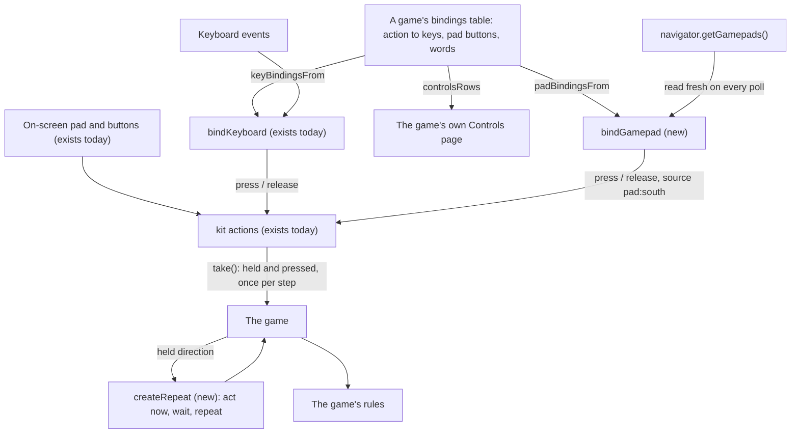

# Gamepad input and one bindings table — Architecture Spec

## In Plain Language

The kit lets a game be played with a keyboard and with on-screen touch controls. Both feed one
list of named actions ("up", "pause", "use"), and the game reads that list once per step. This spec
adds a third way in: a game controller. A pad becomes one more thing that presses and releases the
same actions, so a game's rules never learn which device a press came from.

It also fixes a small duplication both games already have. Each game writes down which keys do
what in one place, and the words that explain those keys to the player in another. This spec gives
the kit one table per game, keyed by action, that holds the keys, the pad buttons and the words
together. The keyboard, the pad and a game's Controls page all read that one table, so the page
cannot fall out of date.

Nothing here changes a game that does not ask for it. A game that moves to this kit version and
edits nothing runs no new code. The spec was asked for by the Into The Dark web port, which is
played mostly by tapping places on a grid, so it also says what such a game needs from the kit to
build a cursor a pad can move, and which of the port's own pieces should move into the kit later.

**This spec builds on `specs/game-kit.md`**, the plan that moves the kit into this repo. That plan's
pull request is open as this is written. Nothing here can start until two of its units have
merged: `gk_kit_on_main`, which puts the kit here, and `gk_cs_adopts`, which lets Cemetery Security
pin a kit branch and so supply the evidence a kit change needs.

## Architecture at a Glance



A game writes one table. Three helpers turn it into what the keyboard binding takes today, what
the new pad source takes, and the rows a Controls page prints. The pad source has no listeners and
no timers: the game calls its `poll()` just before it reads its actions, and `poll` compares the
pad with what it saw last time and presses or releases what changed. From the action list onward
nothing is new. A small pure helper, `createRepeat`, turns "this direction is held" into "act now,
then again after a wait", which a cursor or a menu needs and which a held key can use just as well.

## How It Works (Technical)

Three new kit files, or four with unit 3, and one new test helper. **No existing kit file is edited.**

### Where the games were read

Every statement this spec makes about a game or about today's kit was read at one of these commits.

| Repo | Commit | What was read there |
|---|---|---|
| `cemetery-security` | `50eecdc016ab2e0f78cd5726c7485859c79198f7` | Today's kit, as `specs/game-kit.md` imports it: `web/kit/actions.ts`, `keyboard.ts`, `touch.ts` (`PadDirection`, `padDirection`), `page.ts` (`UnlockableSoundContext`). |
| `cemetery-security` | `39654d7e165fa3635be02571d64025ff16c7d182` (`dev`) | The game: `web/game/mount-game.ts` (the pause menu reads `pressed.up`, `pressed.down` and `pressed.action`; `releaseAll` is called on a screen change only), `web/game/browser-environment.ts`, `web/game/sound.ts` (effects only: no music, groups or suspend), and the four files listed for it under "What changes for each game". `web/kit` is unchanged from `50eecdc`. |
| `into-the-dark-web` | `404ba2a93968440c5f164605a5f0c77fcac0d346` (`build/parity`, the working branch) | `game/pointer.ts` (`gestureAction`, `tapAction`), `game/mount-game.ts` (`isCapturing`, the paused frame, the visibility handler, `releaseAll` on a screen change only), `game/browser-environment.ts`, `game/sound/sound.ts` (suspends its context on a hidden tab), `game/actions.ts`, `game/replay.ts`, `game/content/web-only.ts`, `tools/replay.mjs`, and `specs/into-the-dark-web-parity.md` (unit 8, `itdp_controls_page`). |

Two things named below do not exist at that Into The Dark commit: `game/cursor.ts`, which this
spec asks for, and the Controls page, which is planned as unit 8 of that repo's parity spec and
not yet built.

### `kit/bindings.ts` (pure)

```ts
/** A pad control, named by where it sits on a pad with the browser's `standard` mapping. */
export type PadInput =
  | 'south' | 'east' | 'west' | 'north' | 'left-bumper' | 'right-bumper' | 'start'
  | 'dpad-up' | 'dpad-down' | 'dpad-left' | 'dpad-right'
  | 'stick-up' | 'stick-down' | 'stick-left' | 'stick-right';

export interface Binding {
  /** What the action does, in the player's words. A Controls page prints it. */
  label: string;
  /** `KeyboardEvent.code` values. */
  keys?: readonly string[];
  pad?: readonly PadInput[];
  /** Words only ("Swipe up"). The kit cannot read a game's gestures. */
  touch?: string;
}

/** One entry per action: the single place a game says what gives it. */
export type Bindings<A extends string> = Readonly<Record<A, Binding>>;
export type PadBindings<A extends string> = Readonly<Partial<Record<PadInput, A>>>;

/** Today's `KeyBindings`, for `bindKeyboard`. Throws if one key is given to two actions. */
export function keyBindingsFrom<A extends string>(table: Bindings<A>): KeyBindings<A>;
/** For `bindGamepad`. Throws if one pad input is given to two actions. */
export function padBindingsFrom<A extends string>(table: Bindings<A>): PadBindings<A>;

export interface ControlsRow<A extends string> {
  action: A;
  label: string;
  keys: string[];
  pad: string[];
  touch: string | null;
}
/** The rows of a Controls page, in `order`, with every key and pad input already a label. */
export function controlsRows<A extends string>(
  table: Bindings<A>,
  order: readonly A[],
  labels?: {
    keys?: Readonly<Record<string, string>>;
    pad?: Readonly<Partial<Record<PadInput, string>>>;
  },
): ControlsRow<A>[];

/** 'ArrowUp' gives 'Up arrow', 'KeyW' gives 'W': the letter a US keyboard prints there. */
export function keyLabel(code: string): string;
/** 'south' gives 'Bottom button', 'left-bumper' gives 'Left bumper', 'stick-up' gives 'Stick up'. */
export function padLabel(input: PadInput): string;
```

Pad buttons are named by position, because the kit does not guess who made the pad. A game that
wants "A" or "Cross" passes its own labels. `keyLabel` is wrong on a keyboard that is not laid out
like a US one; a game that knows better passes `labels.keys`. Triggers, stick clicks, the right
stick and the select button are left out of `PadInput` until a game binds one.

```ts
const BINDINGS: Bindings<Action> = {
  up: { label: 'Step up', keys: ['ArrowUp', 'KeyW'], pad: ['dpad-up'], touch: 'Swipe up' },
  pause: { label: 'Pause', keys: ['Escape', 'KeyP'], pad: ['start'] },
  // ...one entry for every action
};
export const KEY_BINDINGS = keyBindingsFrom(BINDINGS);
```

### `kit/gamepad.ts`

```ts
/** What is read of a browser's `Gamepad`. */
export interface PadState {
  readonly connected: boolean;
  readonly mapping: string;
  readonly buttons: readonly { readonly pressed: boolean }[];
  readonly axes: readonly number[];
}
export interface GamepadEnvironment {
  getGamepads(): readonly (PadState | null)[];
}

export const STICK_PRESS = 0.5;   // how far the stick must go to mean a direction
export const STICK_RELEASE = 0.3; // how far back before it means none
export const STICK_SWITCH = 1.5;  // how much stronger the other axis must be to change direction

/** The stick's direction, given the one it had. Pure. One of four, as `padDirection` gives. */
export function stickDirection(x: number, y: number, previous: PadDirection | null): PadDirection | null;

export interface BoundGamepad {
  /** Read the pads and press or release what changed. Call just before every `actions.take()`. */
  poll(): void;
  /** 'none': no pad has been used. 'ready': one is being read. 'unsupported': pads are connected and none has the standard mapping. */
  status(): 'none' | 'ready' | 'unsupported';
  /** Lets go of everything the pad holds. A later `poll` does nothing. */
  dispose(): void;
}

export function bindGamepad<A extends string>(config: {
  actions: Actions<A>;
  bindings: PadBindings<A>;
  environment: GamepadEnvironment;
  /** May this action be pressed now? A press is asked; a release never is. See "Gated like a key while in play". */
  isCapturing(action: A): boolean;
}): BoundGamepad;
```

Behaviour the tests hold:

- **Edge-based.** `poll` compares each bound input with the last poll and calls
  `press(action, 'pad:<input>')` or `release`. Calling `poll` twice before one `take` gives one
  press. A button still down after the game's `releaseAll` does not press again until it is let go
  and pressed.
- **Read fresh every time.** `poll` calls `getGamepads()` on every call and keeps no pad object
  between calls. Chrome hands out a new snapshot each time; a kept one never changes.
- **One active pad, chosen by a press.** No pad is active until one of a standard pad's buttons
  goes down; that button's press counts. A button going down on another standard pad makes that
  one active, after the first pad's holds are released. A stick alone never makes a pad active, so
  a drifting pad does nothing.
- **Standard mapping only.** A pad whose `mapping` is not `'standard'` is never read. `status()`
  reports `'unsupported'` so a Controls page can say so.
- **The stick has hysteresis.** Axes 0 and 1 go through `stickDirection`, and the result holds one
  `stick-*` input at a time. The d-pad is buttons 12 to 15 and is bound separately from the stick,
  so a game can give them different jobs.
- **Gated like a key while in play.** `isCapturing(action)` is asked before a press. It is the
  pad's own: on the screens where the game is in play it must refuse every action the keyboard's
  refuses, so a pad cannot press an action there that the same key cannot. Off those screens a game
  that drives its menus with the pad (unit 3) also lets through the menu actions it chose, where the
  keyboard's refuses everything because the keys belong to the page. A game without unit 3 passes
  the keyboard's function unchanged. A refused press is still recorded as the input being down, so
  a button held while the game starts capturing again does not press: it must be let go and
  pressed. A key behaves the same way, because a held key's repeats are not presses.
- **How the stick is read.** The y axis is negative upward, as the browser gives it. With no
  direction held, the axis with the larger absolute value gives the direction once that value
  reaches `STICK_PRESS`; on a tie it is the horizontal one. A held direction is kept while its own
  axis, measured toward that direction, stays above `STICK_RELEASE`, unless the other axis has
  reached `STICK_PRESS` and is at least `STICK_SWITCH` times the held one, which switches to it.
  Release is measured on the held axis alone, not on the stick's distance from centre. When the
  held direction is let go, the same call reads the stick again as if none were held, so a stick
  reversed on its own axis gives the new direction at once: with `'right'` held,
  `stickDirection(-0.8, 0, 'right')` is `'left'`, and the source releases `stick-right` before it
  presses `stick-left` in that one `poll`.
- **Nothing on the page.** No listeners, no connect events, no timers. A `getGamepads` that throws
  (a permissions policy forbids it, or the page is not served securely) is read as no pads.
- **Disconnect and dispose.** An active pad that is gone, or whose `connected` is false, has its
  holds released and no pad is active. `dispose` releases the holds.

```ts
const pad = bindGamepad({
  actions,
  bindings: padBindingsFrom(BINDINGS),
  environment: { getGamepads: () => navigator.getGamepads?.() ?? [] },
  isCapturing,
});
disposer.add(() => pad.dispose());
```

### `kit/repeat.ts` (pure)

```ts
/**
 * Turns "this direction is held" into "act now": once when it goes down, again
 * after `delaySteps`, then every `intervalSteps`. A change of direction starts over.
 */
export function createRepeat<D extends string>(config: { delaySteps: number; intervalSteps: number }): {
  /** Call once per clock step with the held direction or null. Returns it on the steps to act. */
  step(held: D | null): D | null;
};
```

It reads what is held and knows nothing of pads, so a held arrow key can use it too. The two
numbers are the game's.

### `testing/fake-gamepads.ts`

```ts
export function createFakeGamepads(): {
  environment: GamepadEnvironment;
  /** A pad appears. `mapping` defaults to 'standard'. */
  connect(options?: { mapping?: string }): {
    hold(input: PadInput): void;
    release(input: PadInput): void;
    stick(x: number, y: number): void;
    disconnect(): void;
  };
  /** Make `getGamepads` throw, as a browser that forbids it does. */
  forbid(): void;
};
```

The fake must behave like the strictest browser: **every call to `getGamepads` returns new, frozen
snapshot objects**, and a disconnected pad's slot holds `null`. A source that keeps the first
object it was given then fails the fake, as it would fail Chrome.

### Data flow, one frame

**A real-time game (Cemetery Security).** The clock runs its steps. Each step calls `pad.poll()`
and then its existing `actions.take()`. A paused frame does the same before it reads the pause
menu's presses, so the pad works that menu with nothing more: it already reads `pressed.up`,
`pressed.down` and `pressed.action`.

**A turn-based grid game with a cursor (Into The Dark).** Each step calls `pad.poll()` before
`actions.take()`. A pressed step direction becomes the same move a key gives. Held cursor
directions go through `createRepeat` and move a cursor cell the game owns. A pressed confirm asks
the function the game's tap handler calls once it knows the tapped cell, and hands the result to
the rules by the same path a tap takes.

**The rule for every adopting game:** every `actions.take()` has a `pad.poll()` directly before it.

### The contract for a tile cursor a game builds itself

**The kit provides:** cursor directions, confirm and cancel as ordinary actions (bound to the stick
or the d-pad, the game's choice), and `createRepeat`.

**The game owns:** the cursor's cell, where it may go, how it looks, when it shows, and what
confirm means. The cell is view state. It is not in the rules' state, the save or a recorded run.

**The rule:** confirm goes through the same pure function a tap goes through once the tapped cell
is known, with the cursor's cell where the tapped cell would be, and its result enters the rules by
the same path. The game holds this with a test: for every cell in view and every state that changes
what a tap means (in Into The Dark, a readied spell is one), confirm on a cell and a tap on that
cell give deep-equal rules actions, and a run played by pad replays to the same end state.

In Into The Dark the function a tap goes through is inside `gestureAction` in `game/pointer.ts`,
which checks for a readied spell before it asks `tapAction`. The port splits "what a tap on this
cell means" out of `gestureAction` first, so the cursor's confirm and the tap share it. Pointing
confirm at `tapAction` alone would make a pad cast differ from a tap cast.

### What changes for each game

**Nothing unless it opts in.** A game that moves its pin and edits nothing runs no new code in
play. Its check does more: `kit` and `testing` are copied as whole folders, so the new files, the
fake pad and their tests arrive with the pin, compile under the game's own `tsc` (TypeScript 7 in
Cemetery Security), run in its `vitest`, and in Into The Dark are linted with zero warnings. Under
`specs/game-kit.md`'s definition ("a game must edit its own code to adopt, or will behave
differently without editing anything") this change is **not breaking**. `CONTRACT.md` does not
change. The default that keeps the old behaviour is not calling the new functions.

To adopt, a game:

1. Writes its `Bindings` table and derives `KEY_BINDINGS` from it, deleting its hand-written key
   list and key-name list.
2. Adds `getGamepads` to its browser environment and its fake.
3. Calls `bindGamepad` where it calls `bindKeyboard`, and disposes it. Its `isCapturing` is the
   keyboard's, unless the game uses unit 3; then it also allows the chosen menu actions off the
   screens where the game is in play, and nowhere else (see unit 3).
4. Puts `pad.poll()` directly before every `actions.take()`.
5. **Adds `actions.releaseAll()` to its tab-visibility handler.** Neither game does this today.
   Keys are let go by `bindKeyboard`'s window `blur`; a pad hold would survive a hidden tab. The
   pad source cannot do it, because nothing polls while frames are stopped.

By file, **Cemetery Security:** `web/game/actions.ts`, `web/game/browser-environment.ts`,
`web/game/mount-game.ts`, `web/game/testing/fake-environment.ts`. **Into The Dark:**
`game/actions.ts` (the table, plus cursor, confirm and cancel actions), `game/browser-environment.ts`,
`game/mount-game.ts`, `game/pointer.ts` (the split described above), a new `game/cursor.ts`, its
Controls page once built (rows from `controlsRows`), `game/content/web-only.ts` (the repeat numbers, with
their reason: the Unity game has no pad), and its pin.

### Failure modes

| Case | What happens |
|---|---|
| No pad | `getGamepads` gives nothing; `poll` does nothing; `status()` is `'none'`. |
| Pad plugged in, nothing pressed | Browsers hide a pad until a button is pressed on the page. The first `poll` after that press finds it and counts the press. |
| Non-standard mapping | Never read. `status()` is `'unsupported'`. |
| Two pads | One is active. A button on the other takes over; the first pad's holds are released first. |
| Disconnect mid-hold | Its holds are released and no pad is active. |
| Tab hidden mid-hold | Nothing polls. The game's visibility handler calls `releaseAll` (adoption step 5). The next `poll` compares with the real pad and does not press a held button again. |
| Unmount | `dispose` releases the holds. There is nothing else to remove. |
| Sound not yet allowed | A pad press may not count as the gesture a browser asks for before sound (see Risks). The game holds its own sound context and shows its own "press a key or tap for sound". |
| No Gamepad API, or forbidden | The game's `getGamepads` gives `[]`, or throws and the source reads that as none. |

### Dependencies

- `specs/game-kit.md`: `gk_kit_on_main` and `gk_cs_adopts` merged before units 1 and 2, whose
  evidence comes from Cemetery Security.
- Into The Dark's pin on a `game-kit` `main` commit that holds the newer screen navigation, before
  unit 3, whose evidence comes from Into The Dark.
- The browser Gamepad API, with the `standard` mapping.
- The kit's own `Actions`, `KeyBindings` and `PadDirection`. No new library.

## Key Decisions

Assumptions made for the owner are marked. He has not ruled on them; the pull request that carries
this spec is where he does.

- **A pad is one more source for the action list.** Nothing downstream of `take()` changes, which
  is what keeps a recorded run from caring which device made it.
- **The game polls; the clock is not touched.** A hook on `createClock` was proposed and cut: "call
  `poll` before each `take`" covers every place input is read, with no lag and no edit to an
  existing kit file.
- **The table is keyed by action and is additive.** `KeyBindings` (key to action) stays as it is
  and is derived from the table, so `bindKeyboard` and both games' current code keep working.
- **Touch is words only in the table.** The kit cannot interpret a game's gestures; it can only
  print how the game describes them.
- **Standard mapping only, one active pad, chosen by a button press.** Guessing layouts for other
  pads and merging two pads were both rejected as work nobody has asked for.
- **Four directions from the stick, with hysteresis.** It matches `padDirection` and Cemetery
  Security's touch pad. Without hysteresis a stick resting near a diagonal gives turns nobody asked
  for. (Assumed. Eight directions is the alternative if a game wants stick diagonals.)
- **`bindGamepad` takes `isCapturing`.** Leaving it out was proposed, on the grounds that a pad
  button has no page job to stop. But `bindKeyboard` uses it to decide whether to press at all, and
  Into The Dark's paused frame trusts that gate, so a pad without it could un-pause a run from a
  screen where no key can.
- **The pad's gate is its own, and matches the keyboard's while in play.** (Assumed.) Into The
  Dark's keyboard gate refuses every action off the Play screen on purpose, because there the keys
  belong to the page. Given the same gate, a pad would press nothing on the screens unit 3 is for.
  So a game using unit 3 widens the pad's gate on its menu screens to the menu actions it chose, and
  leaves it equal to the keyboard's in play, which keeps the reason above: a pad still cannot
  un-pause a run from a screen where no key can.
- **The tile cursor is the game's, for now.** (Assumed, following the owner's rule in
  `specs/game-kit.md`: shared things move once two games have shown what is really common.)
- **Only the bindings table moves into the kit now.** Both games already hold the same facts
  twice, and the pad needs the table. Everything else the Into The Dark port built stays, with a
  condition named for when it should move (see the inventory).
- **Cemetery Security supplies the evidence for units 1 and 2; Into The Dark for unit 3.**
  `specs/game-kit.md` asks a kit pull request for the kit commit a game pinned and that game's
  `npm run check` there. Cemetery Security can pin a kit branch as soon as `gk_cs_adopts` has
  merged, its pause menu already works from pressed actions, and its pin is the first time the new
  files compile under TypeScript 7. Into The Dark asked for the table, but cannot pin a newer kit
  until it has taken the newer screen navigation, so it is not made to do that first for units 1
  and 2. Unit 3 is for its menus alone, so there it must.
- **A pad press is treated as not unlocking sound or full screen.** (Assumed; to be confirmed in
  three browsers.) The design does not depend on the answer either way.

### Inventory: what the Into The Dark port built that could live here

**Moves now:** the bindings table (unit 1).

**Not now, and when:**

- **A tile cursor:** when a second game builds one.
- **A recorded run and its playback** (`game/replay.ts`, `tools/replay.mjs`): when Cemetery
  Security records runs. Today it is typed to one game's actions and its Unity baseline.
- **The shared parts of each game's browser environment** (the `time` and `fullScreen` blocks are
  the same in both games): when a kit change next has to touch either copy, or a third game arrives.
- **The sound mixer and its fake** (music groups, crossfade, the duck, suspend on a hidden tab):
  when Cemetery Security needs music or groups. Today it plays effects only, on the kit's
  `UnlockableSoundContext`.

**Stays in the game:** the pointer gestures (`game/pointer.ts`), whose thresholds and meanings are
the Unity game's. `check-dist` and the sync tool are already ruled on in `specs/game-kit.md`.

## Non-Goals / Cut Scope

Rebinding by the player. Rumble. Triggers, the right stick, stick clicks, the select button,
analogue values. Diagonals from the stick. Guessing a pad's maker for button names. Support for
non-standard pads. Connect and disconnect events. Full screen from a pad. A kit Controls page (the
page is each game's). A kit cursor. Reading the keyboard's layout.

Cut by the debate's final review:

- **A last-used-device signal** (`kit/device.ts`). No user today. A game sets its own flag where it
  handles confirm and where its pointer handler fires.
- **`isSoundLocked` and the edit to `kit/page.ts` it needed.** "Not running" is not "locked": Into
  The Dark suspends its own sound context when the tab is hidden, so the function would have shown
  the hint to a player whose sound was already unlocked. The game holds the context and knows its
  own suspends. With this cut, no existing kit file changes.
- **A hook on the clock for polling**, and the claim that the source releases holds when the tab is
  hidden. It cannot: nothing polls then.
- **The repeat helper as its own unit.** It joins unit 2.
- **A sentence about adding the fake to a pin's list of files.** By the time this is built a pin
  copies `testing` as a folder, so the fake arrives by itself.

## Risks & Open Questions

**To confirm with a real pad in Chrome, Firefox and Safari.** Node tests cannot show these. The
design depends only on the items marked.

1. **Whether a pad press counts as the gesture a browser asks for** before sound or full screen.
   Not depended on. If it does not, a game started from a pad is silent until a key or a tap.
2. **A pad is hidden until a button is pressed on the page.** Depended on only as "`poll` finds it
   eventually, and that first press counts".
3. **`mapping` is `'standard'`** for Xbox and PlayStation pads in each browser. Depended on.
   Firefox reports an empty mapping for more pads; those players see "unsupported".
4. **`getGamepads` hands out fresh snapshots (Chrome) or live objects (Firefox), with nulls in
   the list.** The source reads fresh on every poll and skips nulls, so either works.
5. **An unfocused but visible window may stop pad updates.** Harmless: the window's `blur` releases
   keys, the game's `releaseAll` covers the pad, and the edge compare does not press again.

**Open questions for the owner.**

1. **Does a pad work the menus?** Unit 3 lets a pad move through a screen's buttons and press one.
   Without it, a pad cannot press New Game in a game whose menus are page HTML (Into The Dark's
   are); it can still play, pause and resume. The debate's final review wanted it cut outright: a
   pad-started game may be silent until a key or tap anyway, and Cemetery Security does not need
   it. *This spec:* keeps it as the last unit, so cutting it touches nothing else. *He needs to
   say:* keep or cut.
2. **Who watches a real pad, and when?** *This spec:* unit 2 waits on `gk_cs_adopts`; Cemetery
   Security's agent opens a draft pull request pinned to the kit branch, the owner plays it with a
   pad and checks risks 1 to 4, and only then does the kit pull request merge. *He needs to say:*
   whether he has a pad to do it with. If not, the alternative is to merge on Node tests and say
   plainly in the pull request that nothing was watched.
3. **Into The Dark and the newer screen navigation.** It cannot take any kit change from `main`
   until it adopts that navigation (`specs/game-kit.md`, risk 1). *This spec:* units 1 and 2 do not
   need it, because Cemetery Security is their evidence game; unit 3 does, and waits for it.
   *Recommended:* Into The Dark moves its pin in a pull request of its own first, so a scroll
   regression is not mixed in with the pad, the cursor and the Controls page.

## Build Plan

All units are built in `game-kit` and gated by its `npm run check`. Each unit's pull request
carries the seven items `specs/game-kit.md` asks of a kit change. Item 2, the game that needs the
change, and item 4, the game whose pin and `npm run check` are the evidence, are named per unit,
because for units 1 and 2 they are different games. No issue or pull request in Into The Dark asks
for this work; the request is unit 8 (`itdp_controls_page`) of its
`specs/into-the-dark-web-parity.md` at `404ba2a`, which item 2 links.

### 1. `gk_bindings_table` — a game writes one table and gets its key bindings and Controls rows from it

**Precondition:** `game-kit` `main` already holds the kit (`gk_kit_on_main` has merged), and
`gk_cs_adopts` has merged so Cemetery Security can pin the kit branch.

What gets built: `kit/bindings.ts` and its test. The asking game is Into The Dark, whose planned
Controls page is to be built from one table of this shape. The evidence game is Cemetery Security:
it pins the kit branch, edits nothing else, and runs `npm run check`, which compiles the new file
under TypeScript 7 and runs its test.

**Acceptance criteria:**

- [ ] `keyBindingsFrom` of a table gives an object `bindKeyboard` accepts, and a test presses an action through it.
- [ ] A table that gives one key, or one pad input, to two actions throws an error naming the input and both actions.
- [ ] `controlsRows` returns rows in the given order with labels from `keyLabel` and `padLabel`, and a label passed in replaces the default.
- [ ] `padLabel` has a non-empty label for every `PadInput`, held by a test that walks the list.
- [ ] `keyLabel` gives 'Up arrow' for `ArrowUp`, 'W' for `KeyW`, '1' for `Digit1` and 'Space' for `Space`, and returns a code it does not know, such as `IntlBackslash`, unchanged.
- [ ] No file that existed before this unit is changed.

**Out of scope:** any game's table; reading a pad.

### 2. `gk_gamepad_source` — a standard pad presses and releases a game's actions, and a held direction repeats

**Precondition:** unit 1 has merged. The asking game is Into The Dark, whose owner wants
controller support after the Controls page. No issue or spec unit there asks for the pad itself:
unit 8 of its parity spec at `404ba2a` puts "a gamepad" out of its own scope as coming "through the
kit", so item 2 links that line and the debate this spec came from (`studio_run`). The evidence game
is Cemetery Security, as in unit 1, here with the pad wired in on a draft pull request (open
question 2).

What gets built: `kit/gamepad.ts`, `kit/repeat.ts`, `testing/fake-gamepads.ts`, and their tests.

**Acceptance criteria:**

- [ ] A held fake button gives `pressed` for one `take` and `held` until released; two `poll` calls before one `take` give one press; after `actions.releaseAll()` a button still held does not press again until it is released and pressed.
- [ ] The fake returns new frozen snapshots on every `getGamepads` call and `null` in a disconnected slot, and a test shows a button already down when a pad is first seen presses once.
- [ ] No pad is active until one of its buttons goes down; with two pads only the active one feeds actions; a button on the other takes over after the first pad's holds are released; a stick alone does not take over.
- [ ] `stickDirection(0.49, 0, null)` is null and `(0.5, 0, null)` is `'right'`; with `'right'` held, `(0.31, 0)` stays `'right'` and `(0.3, 0)` is null; a stick moved from `(0.8, -0.7)` to `(0.7, -0.8)` and back, starting from null, gives `'right'` every time; with `'right'` held, `(0.4, -0.9)` gives `'up'` and `(-0.8, 0)` gives `'left'`; a fake stick moved from `(0.8, 0)` to `(-0.8, 0)` between two `poll` calls releases `stick-right` and presses `stick-left` in the second one.
- [ ] An action `isCapturing` refuses is not pressed and is still released; a button that went down while its action was refused does not press when capturing turns back on, and does press once it is released and pressed again, so a source that records only accepted presses fails; a non-standard pad gives no action and a `status()` of `'unsupported'`; a disconnect mid-hold, `dispose`, and a throwing `getGamepads` each leave nothing held.
- [ ] `createRepeat` fires on the first held step, on the step `delaySteps` later, then every `intervalSteps`, and a new direction or `null` starts over; `kit/gamepad.ts` contains none of `addEventListener`, `setTimeout`, `setInterval` and `requestAnimationFrame`.
- [ ] No file that existed before this unit is changed.

**Out of scope:** the browser checks under Risks (they are the owner's, with a pad); any game's wiring; a cursor.

### 3. `gk_pad_menu_focus` — a pad player can move through a screen's buttons and press one

**Open question 1 decides whether this unit is built.** Cutting it changes nothing in units 1 and 2.

**Precondition:** unit 2 has merged, and Into The Dark's pin names a `game-kit` `main` commit that
holds the newer screen navigation (open question 3). Into The Dark is both the asking game and the
evidence game: its menus are page HTML, and what the unit does can only be watched there.

What gets built: `kit/menu.ts` and its test.

```ts
/** Moves the browser's own focus through a screen's controls, for a pad. */
export function createMenuFocus(config: {
  /** Where focus is asked: the game's shadow root. */
  root: Pick<ShadowRoot, 'activeElement'>;
  /** The element whose controls are walked now: the current screen, or an open panel. */
  scope(): ParentNode | null;
}): { next(): void; previous(): void; activate(): void };
```

Controls are enabled buttons, links, inputs and selects inside `scope()`, in document order,
skipping anything under a `hidden` element. `next` and `previous` wrap. `activate` calls `click()`
on the focused control. A game calls these from pressed actions it chooses (for example d-pad up
and down, and the bottom button), on the frames where it is not in play, with `pad.poll()` before
its `take()` as everywhere else. The kit clock calls `draw` on every frame even while it is not
running, so those frames exist off the Play screen.

Those presses only arrive if the pad's gate lets them through. Into The Dark's keyboard gate
refuses every action off the Play screen, so the game gives the pad a gate of its own:

```ts
// The actions it already gives the d-pad and the bottom button: one pad input has one action.
const MENU_ACTIONS: ReadonlySet<Action> = new Set(['up', 'down', 'confirm']);
const pad = bindGamepad({
  actions,
  bindings: padBindingsFrom(BINDINGS),
  environment,
  // In play, exactly the keyboard's gate; elsewhere, also the menu actions and nothing else.
  isCapturing: (action) => isCapturing(action) || (currentScreen !== 'play' && MENU_ACTIONS.has(action)),
});
```

The keyboard keeps its own gate, so the page still owns the keys on a menu screen. A menu action
still held when the screen changes to Play is let go by the game's `releaseAll` on a screen change,
and the edge compare does not press it again.

**Acceptance criteria:**

- [ ] The tests mount their buttons inside a shadow root and pass that root, because both games mount in one and `document.activeElement` there is the host, not the button.
- [ ] With three buttons, `next` focuses them in document order and wraps, and `previous` reverses; with nothing focused in scope they focus the first and the last.
- [ ] A disabled button and a button under a `hidden` element are skipped.
- [ ] `activate` clicks the focused control once, and does nothing when focus is outside `scope()` or `scope()` is null.
- [ ] A test wires a fake pad through `bindGamepad`, with a gate built as above from a keyboard gate that refuses every action off a toy Play screen, into `createMenuFocus`: on a menu screen, d-pad down moves focus and the bottom button clicks the focused button; on the Play screen, an action the keyboard gate refuses (as Into The Dark's refuses `advance` while paused) is not pressed by the pad either.
- [ ] Into The Dark's evidence pull request shows a pad moving focus on the Title screen and pressing New Game.
- [ ] The file adds no listener and no element.
- [ ] No file that existed before this unit is changed.

**Out of scope:** left and right, grids, focus styling, full screen, which pad buttons a game uses for it.
